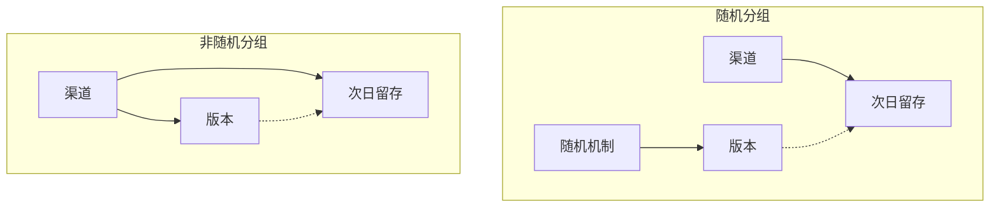
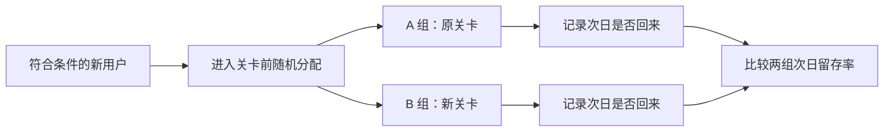

A/B 测试是一种以随机分配为核心的对照实验，研究者将符合条件的实验单位按预定机制分配到不同方案，在事先定义的指标和观察窗口内比较结果，以估计方案对目标人群的平均因果效应。产品改版前后的指标变化会混入时间趋势、用户构成等同期因素，仅凭观察差异难以确认改动本身的作用，而因果问题真正要问的是“同一时期不做改动会怎样”，这一反事实无法直接观测。A/B 测试通过随机分配在同期建立可比的对照，使这些因素不再系统性地造成组间差异，从而为效应大小及其不确定性提供可信依据，帮助团队决定采用、继续验证或调整方案。

<!--more-->

## 从观察到因果问题

一个人开始记录每天上午是否喝咖啡，以及当天完成的任务数。几周后，他发现喝咖啡的日子完成任务更多，并由此认为“咖啡提高了工作效率”。然而这一观察不足以支持该因果结论，睡眠状况、任务难度或工作压力等因素，也可能同时影响饮用咖啡的可能性和任务完成数。

这个例子至少引出三种不同的问题：



| 问题类型 | 研究目标 |
| :---: | :---: |
| 描述 | 喝咖啡的日子，完成的任务数是否更多？ |
| 预测 | 知道一个人当天是否喝咖啡，能否更准确地预测其任务完成数？ |
| 因果 | 如果使他当天喝咖啡，而不是不喝，任务完成数会发生什么变化？ |



前两个问题可以通过对观测数据的描述和建模来回答，第三个问题则涉及干预（Intervention）。即使咖啡与任务完成数高度相关，但这种关联也可能由工作压力造成，工作压力很有可能同时影响一个人喝咖啡的可能性和当天完成的任务数。因此，“喝咖啡的日子完成任务更多”描述的是观察到的差异，不能直接解释为“咖啡提高了任务完成数”这样的因果论断。





上图是问题“喝咖啡是否能提高任务完成数”的因果图（Causal Graph），实线表示工作压力可能同时影响咖啡摄入和任务完成数，虚线表示待检验的咖啡因果效应（Causal Effect）。

因果效应难以直接观察，是因为同一实验单位在同一条件下只能接受一种处理，因此只能观察到一种潜在结果。例如产品实验中，用户在一次实验经历中只能接触一个版本。

预测结果与估计干预的因果效应，是两个不同的研究任务。如果研究目的是预测次日任务完成数，“喝咖啡的日子通常更忙”可能具有预测价值，即使这种关系主要由工作压力驱动。若要据此建议通过饮用咖啡提高工作效率，则必须估计主动改变饮用习惯所产生的因果效应。产品团队决定是否上线新版本时，同样需要评估采取该干预后的结果，而不能只依赖观察到的相关关系。

## 前后对比的局限

假设某款休闲游戏降低了新手第一关的难度，希望减少玩家初次失败后的挫败感。团队在更新前后比较新用户的次日留存率，结果如下：



| 时期 | 新增次留率 |
| :---: | :---: |
| 更新前 | $30\%$ |
| 更新后 | $33\%$ |



可以看到更新后的次日留存率比更新前高 **$3\,\mathrm{pp}$**，相对增幅为 $10\%$。进一步，将前后比较表示为下表。更新后用户实际接触新关卡，因此可以观察到 $33\%$ 的留存率；同一时期这些用户若继续接触原关卡，其留存率则无法直接观察。



| 时期 | 原关卡 | 新关卡 |
| :---: | :---: | :---: |
| 更新前 | $30\%$（已观察到） | 未观察到 |
| 更新后 | 未观察到 | $33\%$（已观察到） |



假设更新后这批新用户若继续使用原关卡，再假设其次日留存率由于其他同期影响为 $32\%$，那么关卡改变所带来的留存率差异为 $1\,\mathrm{pp}$，其余 $2\,\mathrm{pp}$ 则来自同期条件变化。该假设仅用于说明 $30\%$ 与 $33\%$ 的差值可能同时包含版本效应和其他同期变化。

更新前后可能跨越节假日，玩家可支配时间随之变化；投放渠道也可能改变新用户构成；团队还可能同期调整广告频率或其他关卡。即使不存在这些变化，有限样本中的留存率仍会波动。因此，前后比较同时包含版本、时间、人群构成和随机波动的影响，无法仅凭两个汇总值将其分离。

前后比较仍可用于监测指标变化和提出待检验假设，但若要进一步主张“降低难度使次日留存率提高了 $3\,\mathrm{pp}$”，则必须估计反事实结果：**同一时期未调整关卡时，这批目标用户的次日留存率会是多少？**

## 反事实与潜在结果

对每位符合实验条件的用户 $i$，分别记其被分配至新关卡方案和原关卡方案时的次日回访状态为 $Y_i(1)$ 和 $Y_i(0)$。回访记为 1，未回访记为 0。在该结果定义下，用户 $i$ 被分配至新方案相对于原方案的个体因果效应为：

$$
\begin{equation}
  \tau_i=Y_i(1)-Y_i(0)
\end{equation}
$$

这个定义要求比较同一用户在两种方案下的结果。若该用户被分配到新关卡方案，则观测到的是 $Y_i(1)$。同时，该用户在原关卡方案下的 $Y_i(0)$ 不可同时观测，因此 $Y_i(0)$ 是一个 **反事实结果**（Counterfactual Outcome）。反事实结果指该用户在未实际接受的另一处理条件下本可能出现的结果，个体因果效应因此无法由单个用户的观测数据直接计算。

$Y_i(0)$ 和 $Y_1(0)$ 在这里被称为潜在结果（Potential Outcomes），其依赖若干识别条件：处理方案必须定义明确且在实验期间保持一致、一个实验单位的结果不应受其他单位所接受处理的影响等。若新关卡在实验中持续调整，或好友关系、排行榜等机制使不同用户组相互影响，潜在结果的定义便则要进一步明确。这类条件通常概括为稳定单元处理值假设（Stable Unit Treatment Value Assumption, SUTVA），其中包括处理版本一致性和单位间无干扰等要求。

## 随机分配与可信对照

### 渠道构成差异与混杂

将部分用户分配到原关卡，另一些用户分配到新关卡并比较留存率，并不足以保证因果解释成立。若新关卡主要分配给自然流量用户，而原关卡主要分配给付费渠道用户，渠道构成便可能同时影响版本分配和留存结果，造成混杂。

假设新关卡在每个渠道内均使留存率提高 $2\,\mathrm{pp}$，但旧关卡组以付费渠道用户为主，新关卡组以自然渠道用户为主，具体数据如下表所示：



| 渠道 | 原关卡留存率 | 新关卡留存率 | 旧版组中的占比 | 新版组中的占比 |
| :---: | :---: | :---: | :---: | :---: |
| 付费渠道 | $20\%$ | $22\%$ | $80\%$ | $20\%$ |
| 自然渠道 | $40\%$ | $42\%$ | $20\%$ | $80\%$ |



按组内渠道占比加权，旧关卡组留存率为 $24\%$，新关卡组为 $38\%$。两组未经调整的差异为 **$14\,\mathrm{pp}$**，但每个渠道内的版本差异均为 **$2\,\mathrm{pp}$**。这些额外的差异来源于渠道的构成不同，扩大样本量可以降低随机误差，但不会消除这种系统性的组间结构差异。





上图展现了导致上述数据差异的原因。在左图中，渠道同时影响版本分配和次日留存，是可能的混杂因素；而在右图中，版本由随机机制决定，渠道不再系统性地决定用户进入哪个版本组。虚线表示待估计的版本差异的因果效应。

### 随机化的作用

在实验开始前，应先明确哪些用户符合纳入条件。随后在用户进入关卡前，按照预先设定的随机机制将他们分配到两个版本，并记录各组用户的次日回访情况。





随机分配的关键是 **分配发生在结果测量之前，且分配机制独立于潜在结果**。在理想的随机分配机制下，这一条件可表示为：

$$
\begin{equation}
  T_i\perp\!\!\!\perp(Y_i(0),Y_i(1))
\end{equation}
$$

其中 $T_i$ 表示用户被分配到的版本。上式表示分配机制与两种潜在结果独立，但并不意味着实际形成的两组在所有特征上完全相同。有限样本中仍可能出现偶然不平衡，留存率也存在随机波动。随机化的作用是提供已知且预先确定的分配机制，从而为组间因果比较提供识别依据。其优势在于 **按预先确定的机制使处理分配独立于潜在结果**，而非依赖事后完整测量并调整所有混杂因素。

随机化可通过重复分配的思想实验去理解：将本次纳入实验用户的潜在结果视为固定值，并设想对同一批用户按既定机制重复随机分组。各组均值在所有可能分配中的期望，分别对应原方案和新方案下实验人群的平均潜在结果；两组均值之差的随机化期望则对应该实验人群的平均处理效应。这一性质说明了组间差异作为估计量的依据，但不保证任意一次分配所得估计值都等于真实效应。

## A/B 测试与效应估计

要将前述因果推断框架落实为 A/B 测试，需将研究问题转化为可执行的实验设计，即明确处理与对照、分配机制、结果变量和目标人群，并规定如何用组间结果差异估计目标效应。

### 定义问题与指标

本文案例研究问题应明确表述为：“对于本周首次进入新手关卡且符合纳入标准的玩家，分配到指定的新关卡方案后，其次日留存率平均改变多少”。其中，“本周”和纳入标准界定研究人群与时期；“指定的新方案”界定处理；“次日留存”界定结果变量。若这些定义在查看结果后发生变化，估计结果可能对应另一个研究问题。

要把这个研究问题落实为实验设计，需要明确其中每项设定在本例中的具体含义：



| 要素 | 本例中的含义 |
| :---: | :---: |
| 实验单位 | 符合条件的新用户，同一用户应保持固定分组 |
| 处理与对照 | B 组分配到明确定义的新关卡方案，A 组分配到原方案 |
| 分配机制 | 用户进入关卡前，按预设规则随机分配到 A 或 B |
| 结果变量 | 按相同口径记录是否在次日回来 |
| 目标效应 | 新方案分配策略对目标人群平均次日留存概率的影响 |
| 估计量 | B 组与 A 组的次日留存率之差 |



最后两行不可互换。此处的目标效应是指分配到新方案对目标人群结果的平均影响，即意向治疗效应（intention-to-treat effect，ITT）；估计量是按随机分配组计算的留存率差。前者是研究希望估计的总体参数，后者是用观测数据计算该参数的统计量。明确目标人群、处理条件和结果变量后，才能选择相应估计量。

### 分配与处理接触

结果测量的人群定义的选择会影响估计和不确定性计算。若仅分析“成功通过第一关的玩家”，而新关卡本身会影响通关概率，分析样本便由处理后的结果决定。即使困难关卡组的通关者留存率较高，也不能据此推断该关卡提高了原始目标人群的留存。较直接的主要分析方案是：预先界定符合条件并已随机分配的用户，按统一规则测量其后续结果。 这估计的是分配到新关卡策略的效果。未成功接触处理或未进入关卡的情况应予以记录和说明，不应在结果出现后任意从分析分母中排除。

分配到新关卡与实际接触新关卡并不等同。若部分 B 组用户在关卡加载前退出，按原分组比较仍估计上述意向治疗效应，其中包括未实际接触关卡的用户；这一效应通常与上线决策更直接相关。若事后仅保留实际接触新关卡的 B 组用户，样本选择可能破坏随机分配形成的可比性，因为是否接触关卡可能与留存倾向相关。若研究目标是实际接受处理的因果效应，则需另行定义估计目标并满足相应识别条件，不能仅通过排除未接触处理者得到。

### 估计组间差异

假设两组各有 10,000 名随机分配的新用户，A 组有 3,000 人次日回访，B 组有 3,300 人次日回访，具体结果如下：



| 指标 | A 组：原关卡 | B 组：新关卡 |
| :---: | :---: | :---: |
| 随机分配的新用户 | 10,000 | 10,000 |
| 次日回来的用户 | 3,000 | 3,300 |
| 次日留存率 | $30\%$ | $33\%$ |



那么两组次日留存率之差的估计值为：

$$
\hat{\tau}=\overline{Y}_B-\overline{Y}_A=0.33-0.30=0.03
$$

在随机分配有效、结果测量准确且实验单位之间不存在干扰等条件下，两组次日留存率之差可解释为意向处理效应。若用户实际接受的处理与分配方案一致，则该估计值也可解释为目标人群的平均因果效应。本例中的 $3\,\mathrm{pp}$ 来自同一时期的随机分组；虽然数值与前后比较中的“$30\%$ 对 $33\%$”相同，其因果解释依据并不相同。

该结论仍有适用边界。它既不表示每位用户的留存概率都提高了 $3\,\mathrm{pp}$，也不能直接外推至所有渠道、地区和未来时期。若新关卡同时改变奖励和广告入口，实验识别的是 **整套方案变化** 的效果，不能将其单独归因于难度调整。

### 实验效果的适用范围

即使随机分配按设计执行，实验结果直接支持的仍是 **本次实验条件下** 所定义方案对所定义人群的平均效应。未来玩家来源、版本内容和用户适应程度都可能变化。将实验结果外推至未来上线，需要判断目标情境与实验情境是否足够相似，并结合后续监测。必要时应在不同渠道或时期重复实验。

总体平均效应也可能掩盖处理效应的异质性。若新关卡提高了初次接触游戏用户的留存，却降低了熟悉同类游戏用户的留存，总体 $+3\,\mathrm{pp}$ 将取决于两类用户在实验样本中的比例。上线后人群构成变化，总体效应也可能随之变化。预先指定的亚组分析有助于评估效应异质性。

## 估计误差与实验有效性

### 估计精度与样本量

仍以 $30\%$ 对 $33\%$ 为例。若每组各有 100 人，则分别有 30 人和 33 人次日回来；若每组各有 10,000 人，则分别有 3,000 人和 3,300 人次日回来。两种样本量下的点估计均为 **$+3\,\mathrm{pp}$**，但小样本中少数用户的结果变化会显著影响估计值，因此其抽样分布通常更分散。

在其他设计条件相同的情况下，样本量会影响估计精度。下表以相同的点估计为例，展示不同样本量下标准误与置信区间的差异。数值仅用于说明，不代表特定实验的分析结果。

{% table id="precision-by-sample-size" caption="不同样本量下留存率差异的标准误与 $95\%$ 置信区间（示意）" %}

| 每组人数 | 观察到的差异 | 标准误 | $95\%$ 置信区间 |
| :---: | :---: | :---: | :---: |
| 100 | $+3\,\mathrm{pp}$ | $6.6\,\mathrm{pp}$ | $[-9.9,\,+15.9]\,\mathrm{pp}$ |
| 10,000 | $+3\,\mathrm{pp}$ | $0.66\,\mathrm{pp}$ | $[+1.7,\,+4.3]\,\mathrm{pp}$ |



每组 100 人时，区间较宽且包含 0，数据与负向、接近 0 及正向效应均相容，单凭点估计难以支持明确判断。每组 10,000 人时，区间明显收窄且整体高于 0，估计方向更明确。置信区间刻画的是目标效应估计的不确定性；其解释仍以实验设计和分析方法有效为前提，不能弥补分组偏差、结果测量错误或处理后筛选。

解释实验结果时，应分别评估以下三个方面：

1. **效应大小**：观察到的差异有多大？应区分 pp 变化与相对百分比变化。
2. **估计精度**：置信区间有多宽？区间是否仍包含方向相反或业务意义不同的效应值？
3. **实验有效性**：分配、处理接触和结果记录是否符合设计？是否存在跨组、数据缺失、处理后筛选或单位间干扰？

统计显著或估计精确并不自动意味着效果具有业务价值。若改动收益很小，却需要长期维护复杂的双版本逻辑，统计上可识别的提升也未必值得实施。对于成本较低且风险可控的改动，团队则可能选择继续收集证据，而不是因首次实验精度不足便判定方案无效。统计方法用于度量证据，业务价值阈值仍需结合开发、维护和用户体验成本确定。

### 随机误差与设计偏差

上述区间主要反映实验按设计运行时，随机分配和有限样本带来的不确定性。另一类风险是 **实际比较偏离预定实验设计**。例如计划按 $1:1$ 分配，日志却显示 $60\%$ 的用户进入 B 组、$40\%$ 进入 A 组；原因可能涉及分配规则、记录过程或纳入分析的条件。组间人数比例异常本身并不直接证明效应估计有偏，但需要核查分配机制、用户流转和计数口径。

结果缺失的影响取决于缺失机制。若记录失败与组别和留存无关，主要影响可能是估计精度；若 B 组低端设备用户更容易在加载新关卡时发生结果缺失，被排除用户就可能系统性地不同于被保留用户。**随机误差可通过增加有效样本量降低，设计或测量偏差则需从产生过程加以修正**。

实验过程也会影响统计推断。若因 B 组暂时领先而提前停止，或因其暂时落后而延长收集，最终差异便不能按固定观察窗口下的常规方法直接解释。若同时检验大量指标并仅报告上升项，也会增加偶然发现的风险。本文不展开序贯检验等方法，但应指出：**分析规则若依赖已观测结果，推断方法就必须相应调整**。

## 因果证据与业务决策

假设进一步分析支持“新关卡提高了次日留存”。团队是否应该立即全面上线？仍需考虑关卡推进速度、后续留存、广告接触、收入、玩家体验和实施成本。新关卡可能让更多人第二天回来，却使挑战感下降；也可能帮助新玩家跨过最难的门槛，带来长期收益。一次只看次日留存的实验无法替团队完成这些取舍。

这里存在三个相连、却各不相同的判断：



| 判断 | 核心问题 |
| :---: | :---: |
| 因果识别 | 观察到的差异，能否归因于新关卡？ |
| 统计推断 | 效应可能有多大，我们有多大把握？ |
| 业务决策 | 综合收益、成本与风险，是否值得采用？ |



前两个判断解决证据本身的问题，业务决策则要把证据转化为具体行动。这既包括是否上线，也包括以什么方式上线。

因此，实验前应确定主要结果、护栏指标（guardrail metrics）和最小业务价值阈值 $\delta$。主要结果可以是次日留存；护栏指标可包括后续留存、关卡完成节奏和广告体验，用于监测主要指标改善是否伴随其他重要结果恶化；$\delta$ 是改动的收益刚好覆盖开发、维护和风险成本所需的最小效应。例如，团队可规定次日留存至少提升 $1\,\mathrm{pp}$ 才值得上线（$\delta=1\,\mathrm{pp}$），七日留存不得出现具有实际意义的下降。这里的 $1\,\mathrm{pp}$ 仅为示例，实际取值应依据产品规模、收益模型和风险承受能力确定。判定标准在实验前约定，可降低事后选择性报告的风险。

### 从证据到行动

决策关心的不是置信区间是否包含 $0$，而是它与 $\delta$ 的相对位置。护栏指标应先于主要指标检查：护栏明显恶化时，主要指标的改善不能单独支持上线。护栏无恶化时，可按区间位置判断：



| 区间位置 | 证据状态 | 倾向的行动 |
| :---: | :---: | :---: |
| $L > \delta$ | 效应足够大，且较确定 | 推进，方式取决于风险与可逆性 |
| $0 < L \leq \delta \leq U$ | 方向明确，但幅度不确定 | 小范围推进，并继续观察 |
| $L \leq 0$ 且 $U \geq \delta$ | 数据与无效应、有害和值得上线的效应均相容 | 补充证据，或视成本缩小范围 |
| $0 \leq U < \delta$ | 即使有效，也达不到阈值 | 放弃 |
| $U < 0$ | 有害 | 不上线；已上线则回滚 |



第 3 行与第 4 行的区别值得注意：前者的区间仍包含值得上线的效应，现有证据不足以放弃；后者的区间已排除这类效应，继续投入的依据不足。因此，“未达到统计显著”本身不是放弃的理由，是否放弃取决于区间是否仍覆盖有业务价值的效应。该表用于说明决策的推理方式，并非机械的上线规则，护栏指标的恶化标准同样需要事先约定。

### 推出方式的选择

确定“推进”之后，仍需选择推出方式。不同方式在可逆性、对照的保留和证据的持续积累上差别很大：



| 行动 | 适用情形 | 前提与风险 |
| :---: | :---: | :---: |
| 直接全量 | 证据充分、改动小，且可快速回滚 | 失去同期对照；上线后的指标变化重新变成前后比较 |
| 灰度推全 | 效应为正，但担心规模放大、系统稳定性或护栏指标 | 放量须保持随机分配和同期对照；仅按时间或地区逐步放量，则缺少可比对照 |
| 分层推出 | 在事先指定的人群中，效应差异明显，甚至方向相反 | 亚组须事前定义；事后划分出的亚组只能作为待验证的假设 |
| Holdout | 担心新奇效应消退、长期效应不明，或多项改动的效果累积 | 需长期保留一小部分随机用户使用旧版本，存在机会成本 |
| 调整后再实验 | 主要指标改善但伴随明显副作用，或预期机制未得到支持 | 调整后的方案对应新的研究问题，需重新随机分配，不能沿用原实验数据直接下结论 |
| 回滚或放弃 | 效应有害，或提升达不到最小业务价值阈值 | 回滚触发条件应事先规定；放弃前应区分“确认无效”与“证据不足” |



其中，分层推出指按人群效应的差异决定推出对象，与“先在低风险渠道试推”的风险控制不同，后者属于灰度的一种形式。灰度推全也并非总是实验：若放量用户由随机机制选出，并保留同期的对照组，仍可估计放量后的效应；若只是逐日扩大覆盖面，指标变化就重新混入时间和人群构成的影响，回到前后比较的问题。

选择哪种方式，通常取决于四点：证据强度，即区间与 $\delta$ 的关系；可逆性与回滚成本；不同人群的效应是否一致；规模放大后和长期的不确定性。影响较大且难以回滚的改动，通常需要更充分的证据；成本较低、可快速回滚的改动，可以更早进入灰度。

### 同一实验的不同走向

仍以新手关卡为例，设 $\delta=1\,\mathrm{pp}$。同样是“次日留存提升”，不同的区间、护栏和人群结果，会导向不同的行动：



| 假设的实验结果 | 对应情形 | 可能行动 |
| :---: | :---: | :---: |
| $\hat{\tau}=+3\,\mathrm{pp}$，$[+1.7,+4.3]$，七日留存和广告体验稳定 | $L>\delta$，护栏无恶化 | 灰度推全，放量期间保持对照 |
| $\hat{\tau}=+3\,\mathrm{pp}$，但七日留存明显下降 | 护栏恶化 | 调整关卡方案后重新实验 |
| $\hat{\tau}=+1\,\mathrm{pp}$，$[-0.5,+2.5]$ | $L\leq 0,\ U\geq\delta$ | 补充证据，或在全量成本较高时缩小范围 |
| 新用户次留上升，回流用户次留下降 | 事先指定的亚组方向相反 | 只对新用户推出 |
| $\hat{\tau}=+0.4\,\mathrm{pp}$，$[+0.1,+0.7]$（样本量很大） | $0\leq U<\delta$ | 放弃，或寻找更低成本的实现方式 |



各行的样本量不同，因此区间宽度不具可比性，表中数值仅用于说明决策逻辑。

点估计接近零或方向与预期相反的实验，同样提供有价值的信息。结果可能削弱原有假设，避免资源继续投入无效改动；也可能表明预期机制未能改变目标结果，例如降低难度减少了首次失败，却未提高次日留存。实验结果不仅用于决定是否上线，也可用于修正理论假设和后续设计。

## 评估实验结论

观察到指标变化后，应先明确：比较的是哪两种处理情形？若未实施该干预，目标人群的结果会如何？现有设计能否将干预效应与其他因素的影响区分开？

设想团队收到这样一份新手关卡实验的报告：

新关卡使次日留存提升 10%，p < 0.05，建议全量上线。
{:.info}

可沿用表  的三个判断逐层审阅。

因果识别：差异能否归因于新关卡？ 先确认报告估计的是所有已随机分配用户的意向治疗效应，还是只保留了通关用户的比较，后者按处理后的结果筛选样本，随机分组的可比性不再成立。再核对分配是否按设计执行：计划 $1:1$ 分配，日志却显示 B 组 $10{,}400$ 人、A 组 $9{,}600$ 人，则

$$
\chi^2=\frac{400^2}{10{,}000}+\frac{400^2}{10{,}000}=32,\qquad p\approx 1.5\times10^{-8}
$$

这样的偏离不能归因于随机波动。人数失衡本身不直接证明估计有偏，但必须先查明分配规则、记录过程或纳入路径的问题，再解读效应。此外还需检查结果缺失是否与组别相关，以及两组用户之间是否存在干扰。

统计推断：效应有多大，把握有多大？ “提升 $10\%$”是相对变化，应同时给出 $3\,\mathrm{pp}$ 的绝对变化。仅报告 $p<0.05$ 不足以判断：每组 $10{,}000$ 人时区间为 $[+1.7,\,+4.3]\,\mathrm{pp}$，每组 $100$ 人时为 $[-9.9,\,+15.9]\,\mathrm{pp}$，点估计相同，可支持的结论却不同。还应核对观察窗口是否固定、有无提前停止或只报告上升的指标。

业务决策：证据能否支持行动？ 将区间与最小业务价值阈值 $\delta$ 对照，根据表  检查，再按可逆性与风险根据表  选择推出方式。同时确认结论的适用范围：实验直接支持的是本次人群与时期；若新关卡同时改了奖励或广告入口，也不能把效果单独归因于“难度下降”。

据此，开头的报告可改写为数据能够支持的表述：



| 报告中的表述 | 问题 | 数据支持的表述 |
| :---: | :---: | :---: |
| 新关卡使留存提升 10% | 缺少绝对变化、人群与分母 | 对本周符合条件的新用户，次日留存估计提高 3 pp（相对约 10%） |
| $p<0.05$，因此有效 | 未给出效应大小与区间，也未与阈值比较 | 估计 +3 pp，区间 [+1.7, +4.3]，整体高于 $\delta$ |
| 差异不显著，说明没有作用 | 把证据不足当作无效应 | 区间仍包含值得上线的效应，不能据此放弃 |
| 降低难度减少了挫败感，所以留存上升 | 把整套方案的总效应当作作用机制 | 整套新关卡方案提高了次日留存；机制需另行检验 |



A/B 测试通过随机分配构造“同一时期、同一人群、仅方案不同”的反事实比较。评估结论，就是检查这些条件是否成立，并据此判断数据能把结论支持到多强。
