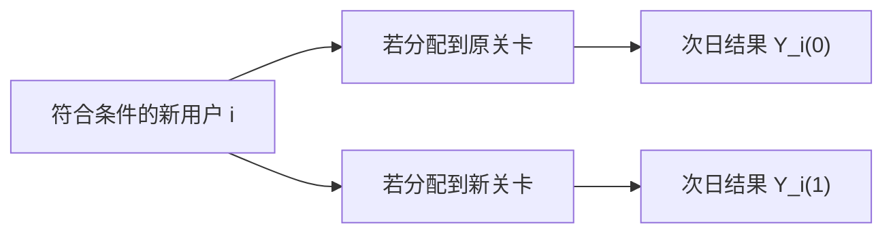
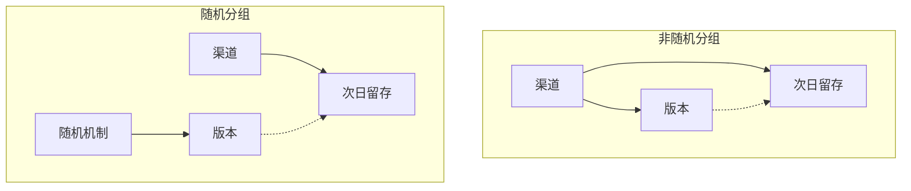
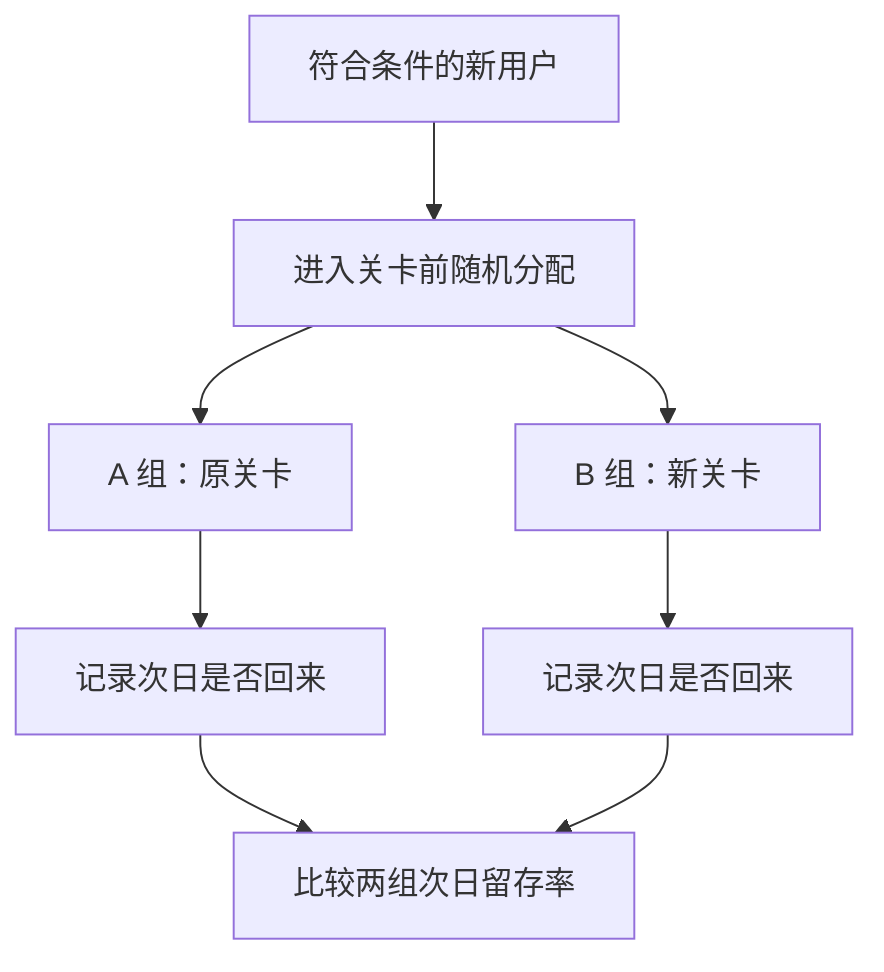

A/B 测试是一种以随机分配为核心的对照实验。研究者将符合条件的实验单位分配到不同方案，在预先定义的指标和观察窗口内比较结果，以估计方案改变对目标人群的平均因果效应。产品改版前后的指标变化也可能受到时间趋势、用户构成和其他同步变化的影响，因此仅凭观察差异难以确认改动本身的作用。通过建立同期可比的对照，A/B 测试为评估效应大小及其不确定性提供依据，并帮助团队决定采用、继续验证或调整方案。本文将从反事实问题出发，讨论随机化为何有效、实验结论有哪些边界，以及如何将结果用于决策。

<!--more-->

## 从观察到因果问题

一名工作者开始记录每天上午是否喝咖啡，以及当天完成的任务数。几周后，他发现喝咖啡的日子完成任务更多，并据此认为咖啡提高了工作效率。然而，这一观察不足以支持因果结论。睡眠状况、任务难度或工作压力等因素，也可能同时影响饮用咖啡的可能性和任务完成数。

这个例子至少引出三种不同的问题：



| 问题类型 | 研究目标 |
| :---: | :---: |
| 描述 | 喝咖啡的日子，完成的任务数是否更多？ |
| 预测 | 知道一个人当天是否喝咖啡，能否更准确地预测其任务完成数？ |
| 因果 | 如果使他当天喝咖啡，而不是不喝，任务完成数会发生什么变化？ |



前两个问题可以通过对观测数据的描述和建模加以回答；第三个问题则涉及干预。即使咖啡与任务完成数高度相关，这种关联也可能由工作压力造成，因为工作压力可能同时影响饮用咖啡的频率和任务完成数。因此，不能直接将“喝咖啡时完成任务更多”解释为“咖啡增加了任务完成数”。





图中的实线表示工作压力可能同时影响咖啡摄入和任务完成数；虚线表示待检验的咖啡因果效应。观察到咖啡摄入与任务完成数相关，并不能排除该关联由“咖啡摄入 $\leftarrow$ 工作压力 $\rightarrow$ 任务完成数”这一后门路径产生，因此不能仅凭相关性确认虚线所示的因果效应。

因果效应难以直接观察，是因为同一实验单位在同一条件下只能接受一种处理，因此只能观察一种潜在结果。产品实验中，用户在一次实验经历中也只能接触一个版本。预测结果与估计干预的因果效应，是两个不同的研究任务。

如果研究目的是预测次日任务完成数，“喝咖啡的日子通常更忙”可能具有预测价值，即使这种关系主要由工作压力驱动。若要据此建议通过饮用咖啡提高工作效率，则必须估计主动改变饮用习惯所产生的因果效应。产品团队决定是否上线新版本时，同样需要评估采取该干预后的结果，而不能只依赖观察到的相关关系。

即使连续记录一年，并使“喝咖啡的日子完成任务更多”成为稳定的统计规律，因果问题仍未解决。增加观测次数可以提高对既有关系的描述精度；但只要工作压力同时影响咖啡摄入和任务完成数，单凭这些观测数据就无法区分咖啡的作用与工作压力的影响。样本量影响估计精度，研究设计则决定比较能否识别目标因果效应。

这一例子还涉及结果测量问题：任务完成数并不必然等同于工作效率，任务难度和完成质量也会影响对效率的判断。即使咖啡确实增加任务完成数，也需要判断该指标是否对应研究者真正关心的结果。产品实验同样需要先界定目标结果，再确定相应的测量指标。

产品分析中常见的推断是：版本更新后指标上升，因此增长由更新造成。要识别干预效应，必须考虑反事实问题：**如果同一时期没有实施这项改变，目标用户的结果会如何？** 团队需要的不只是不同版本用户表现的差异，还需要估计将用户分配到新版本所造成的结果变化。为此，比较方案必须在结果产生前确定。

## 前后对比的局限

假设某款休闲游戏降低了新手第一关的难度，希望减少玩家初次失败后的挫败感。团队在更新前后比较新用户的次日留存率，结果如下：



| 时期 | 新增次留率 |
| :---: | :---: |
| 更新前 | $30\%$ |
| 更新后 | $33\%$ |



表中更新后的次日留存率比更新前高 **$3\,\mathrm{pp}$**，相对增幅为 $10\%$。这一前后差异本身并不能识别关卡更新的因果效应。

可将前后比较表示为下表。更新后用户实际接触新关卡，因此可以观察到 $33\%$ 的留存率；同一时期这些用户若继续接触原关卡，其留存率则无法直接观察。



| 时期 | 原关卡 | 新关卡 |
| :---: | :---: | :---: |
| 更新前 | $30\%$（已观察） | 未观察 |
| 更新后 | 未观察 | $33\%$（已观察） |



假设更新后这批新用户若继续使用原关卡，其次日留存率会因假期等同期因素达到 $32\%$。在这一假设下，关卡改变对应的差异为 $1\,\mathrm{pp}$，其余 $2\,\mathrm{pp}$ 则来自同期条件变化。$32\%$ 并非已观测结果；该假设仅用于说明，$30\%$ 与 $33\%$ 的差值可能同时包含版本效应和其他同期变化。

更新前后可能跨越节假日，玩家可支配时间随之变化；投放渠道也可能改变新用户构成；团队还可能同期调整广告频率或其他关卡。即使不存在这些变化，有限样本中的留存率仍会波动。因此，前后比较同时包含版本、时间、人群构成和随机波动的影响，无法仅凭两个汇总值将其分离。

两个留存率还可能采用不同的统计口径。例如，更新后仅统计实际进入关卡的玩家，而更新前统计所有注册玩家，则分母发生变化，观测差异可能由记录规则造成。在解释差异前，应先确认两期指标采用一致的定义和分母。口径一致并不能消除时间与人群构成变化，但口径不一致会使比较失去可解释性。

前后比较仍可用于监测指标变化和提出待检验假设。若要进一步主张“降低难度使次日留存率提高了 $3\,\mathrm{pp}$”，则必须估计反事实结果：**同一时期未调整关卡时，这批目标用户的次日留存率会是多少？**

## 反事实与潜在结果

设想有一名符合实验条件的新用户 $i$。用 $Y_i(1)$ 表示他被分配到新关卡方案后是否在次日回来，用 $Y_i(0)$ 表示他被分配到原关卡方案后是否在次日回来；回来记为 1，没有回来记为 0。在这个明确的结果定义下，分配到新方案对这名用户的个体因果效应是：

$$
\begin{equation}
  \tau_i=Y_i(1)-Y_i(0)
\end{equation}
$$

这个定义要求比较同一用户在两种方案下的结果。下图展示了这两种潜在结果分别对应什么，以及为什么实际只能观察其中一种。





若该用户被分配到新关卡方案，观测到的是 $Y_i(1)$；同一用户在原关卡方案下的 $Y_i(0)$ 则不可同时观测。$Y_i(0)$ 是一个 **反事实结果**，指该用户在未实际接受的另一处理条件下本可能出现的结果。个体因果效应因此无法由单个用户的观测数据直接计算。

由于结果变量“次日是否回来”是二元变量，$Y_i(0)$ 和 $Y_i(1)$ 只能取 0 或 1，个体效应 $\tau_i$ 因而只能取 $-1$、$0$ 或 $1$。不同用户的个体效应可能不同。文中所说的“留存提高 $3\,\mathrm{pp}$”指 **群体平均结果之差**，不能解释为每位用户的留存概率均增加 $3\%$。

上述潜在结果记号依赖若干识别条件。首先，处理方案必须定义明确且在实验期间保持一致；其次，一个实验单位的结果不应受其他单位所接受处理的影响。若新关卡在实验中持续调整，或好友关系、排行榜等机制使不同用户组相互影响，潜在结果的定义便需要进一步明确。这类条件通常概括为稳定单元处理值假设(SUTVA)，其中包括处理版本一致性和单位间无干扰等要求。

增加样本量不能消除个体反事实不可观测的问题。即使大量用户都体验新关卡，我们仍不知道这些用户在相同条件下体验原关卡会产生什么结果。产品决策通常关注特定目标人群的 **平均因果效应**：对符合条件的新用户，分配到新关卡方案是否改变了平均次日留存率？

若能同时观察目标人群中每位用户在新、旧方案下的潜在结果，便可分别计算两种方案下的平均留存率并求差，得到平均因果效应。现实中，每位用户只能接受一种方案，因此两列潜在结果各有一部分缺失。实验设计的目标是使已观测的组间结果能够识别两种方案下的目标人群平均结果，而不是恢复每位用户未观测的个体结果。

平均效应必须对应明确的目标人群。若实验仅纳入特定渠道的手机新用户，直接适用的结论首先针对该人群；若目标是下个月来自所有渠道的新用户，则需评估实验样本与目标人群在渠道构成等方面的差异。新手与回流玩家对同一关卡调整的反应也可能不同。总体平均效应有助于决策，但不能替代目标人群界定，也不意味着个体效应相同。

此外，反事实中的“未调整关卡”必须有明确的操作定义。维持原关卡并保持同期运营安排，与同时取消投放和新手奖励，是不同的反事实情境。若研究问题未明确界定比较条件，即使估计精确，也无法确定其对应的干预内容。

因此，研究问题从个体层面的反事实不可观测，转向如何构造可信的对照，使一组用户的观测结果能够为另一处理条件下的平均结果提供估计依据。这是对照组设计的核心目的。

## 随机分配与可信对照

将部分用户分配到原关卡，另一些用户分配到新关卡并比较留存率，并不足以保证因果解释成立。若新关卡主要分配给自然流量用户，而原关卡主要分配给付费渠道用户，渠道构成便可能同时影响版本分配和留存结果，造成混杂。

### 渠道构成差异与混杂

以下为说明混杂问题的假设数据。设新关卡在每个渠道内均使留存率提高 $2\,\mathrm{pp}$，但旧关卡组以付费渠道用户为主，新关卡组以自然渠道用户为主：



| 渠道 | 原关卡留存率 | 新关卡留存率 | 旧版组中的占比 | 新版组中的占比 |
| :---: | :---: | :---: | :---: | :---: |
| 付费渠道 | $20\%$ | $22\%$ | $80\%$ | $20\%$ |
| 自然渠道 | $40\%$ | $42\%$ | $20\%$ | $80\%$ |



按组内渠道占比加权，旧关卡组留存率为 $20\%\times80\%+40\%\times20\%=24\%$；新关卡组为 $22\%\times20\%+42\%\times80\%=38\%$。两组未经调整的差异为 **$14\,\mathrm{pp}$**，而每个渠道内的版本差异均为 **$2\,\mathrm{pp}$**。额外差异来自两组渠道构成不同。扩大样本量可以降低随机误差，但不会消除这种系统性的组间构成差异。





左图中，渠道同时影响版本分配和次日留存，是可能的混杂因素；右图中，版本由随机机制决定，渠道不再系统性地决定用户进入哪个版本组。虚线表示待估计的版本效应。随机分配阻断了由渠道导致的系统性版本选择，但不保证有限样本中两组渠道占比完全相同。

### 随机化的作用

实验实施前，应先界定纳入标准，再按预先规定的随机机制将符合条件的用户分配到不同版本：





随机分配的关键是 **分配发生在结果测量之前，且分配机制独立于潜在结果**。在理想的随机分配机制下，这一条件可表示为：

$$
\begin{equation}
  T_i\perp\left(Y_i(0),Y_i(1)\right)
\end{equation}
$$

其中 $T_i$ 表示用户被分配到的版本。该式表示分配机制与两种潜在结果独立，并不意味着实际形成的两组在所有特征上完全相同。有限样本中仍可能出现偶然不平衡，留存率也存在随机波动。随机化的作用是提供已知且预先确定的分配机制，从而为组间因果比较提供识别依据。

随机化可通过重复分配的思想实验理解。将本次纳入实验用户的潜在结果视为固定，并设想对同一批用户按既定机制重复随机分组。各组均值在所有可能分配中的期望，分别对应原方案和新方案下实验人群的平均潜在结果；两组均值之差的随机化期望则对应该人群的平均处理效应。这一性质说明了组间差异作为估计量的依据，但不保证任意一次分配所得估计值都等于真实效应。

若运营人员手动将高价值用户加入 B 组，或系统依据设备性能决定版本，实际分配便偏离了预定随机机制。因此，实验应保存分配日志，并核查组别人数、分配规则及用户进入分析样本的路径。分配机制被破坏后，后续统计调整不能自动恢复随机实验所提供的可比性。

因此，先上线再从历史数据中匹配特征相似的用户，不能直接替代随机分配。研究者可以匹配注册时间、设备和渠道，却可能缺少兴趣、动机、可支配时间等未观测因素，也难以确认这些因素在各组中的作用方式相同。随机分配的优势在于 **按预先确定的机制使处理分配独立于潜在结果**，而非依赖事后完整测量并调整所有混杂因素。随机分配也不能消除跨组接触、记录错误或差异性结果缺失等执行问题。

还需区分随机分配与随机抽样。**随机分配** 旨在建立实验组间的可比性；**随机抽样** 关系到样本对更广目标人群的代表性。随机分组本身不会使实验结果自动适用于所有国家、渠道和未来时期。

A/B 测试是因果研究设计的一种，并非适用于所有问题。已发生的政策变化无法事后随机分配；影响整个平台的产品改动也可能使实验单位之间相互干扰。此时可以考虑观察性研究或准实验设计，但必须明确其识别假设及局限。无法随机实验并不意味着因果问题消失，而是需要依赖不同的设计和假设。

## A/B 测试与效应估计

要将前述因果推断框架落实为 A/B 测试，需将研究问题转化为可执行的实验设计：明确处理与对照、分配机制、结果变量和目标人群，并规定如何用组间结果差异估计目标效应。

### 定义问题与指标

研究问题应明确表述为：“对于本周首次进入新手关卡且符合纳入标准的玩家，分配到指定的新关卡方案后，其次日留存率平均改变多少？”其中，“本周”和纳入标准界定研究人群与时期；“指定的新方案”界定处理；“次日留存”界定结果变量。若这些定义在查看结果后发生变化，估计结果可能对应另一个研究问题。

在新手关卡的例子中，几个词对应着具体的设计选择：



| 要素 | 本例中的含义 |
| :---: | :---: |
| 实验单位 | 符合条件的新用户；同一用户应保持固定分组 |
| 处理与对照 | B 组分配到明确定义的新关卡方案，A 组分配到原方案 |
| 分配机制 | 用户进入关卡前，按预设规则随机分配到 A 或 B |
| 结果变量 | 按相同口径记录是否在次日回来 |
| 目标效应 | 新方案分配策略对目标人群平均次日留存概率的影响（意向治疗效应） |
| 估计量 | B 组与 A 组的次日留存率之差 |



最后两行不可互换。**目标效应** 是研究希望估计的总体参数；**估计量** 是根据观测数据计算该参数的统计量。此处按随机分配组计算的差异对应意向治疗效应(intention-to-treat effect，ITT)，即分配到新方案对结果的平均影响，不要求所有用户都实际接触该方案。明确目标人群、处理条件和结果变量后，才能选择相应估计量。

这些定义还应转化为可执行的记录规则。例如，使用稳定的用户标识在首次进入新手关卡前完成分配，并在实验期间维持原分组；仅改变计划检验的关卡配置，并使同期运营活动在两组间保持一致；将 **所有已分配且符合条件的用户** 纳入主要分析分母；预先规定“次日”按自然日还是按进入游戏后的时间窗口计算。指标口径可因研究目的而异，但必须与预先界定的因果问题一致。

### 分配与处理接触

实验单位的选择会影响估计和不确定性计算。若按访问次数分配，同一玩家可能先后接触原关卡和新关卡，后续结果还会受到先前经历影响；不同访问不能视为相互独立的实验单位。对于新手关卡实验，通常应以用户为实验单位，并在实验期内保持其分组不变。

结果测量的人群定义同样重要。若仅分析“成功通过第一关的玩家”，而新关卡本身会影响通关概率，分析样本便由处理后的结果决定。即使困难关卡组的通关者留存率较高，也不能据此推断该关卡提高了原始目标人群的留存。较直接的主要分析方案是：**预先界定符合条件并已随机分配的用户，按统一规则测量其后续结果。** 这估计的是分配到新关卡策略的效果。未成功接触处理或未进入关卡的情况应予以记录和说明，不应在结果出现后任意从分析分母中排除。

分配到新关卡与实际接触新关卡并不等同。若部分 B 组用户在关卡加载前退出，按原分组比较所估计的是 **分配策略的意向治疗效应(ITT)**，其中包括未实际接触关卡的用户；这一效应通常与上线决策更直接相关。若事后仅保留实际接触新关卡的 B 组用户，样本选择可能破坏随机分配形成的可比性，因为是否接触关卡可能与留存倾向相关。若研究目标是实际接受处理的因果效应，则需另行定义估计目标并满足相应识别条件，不能仅通过排除未接触处理者得到。

实验单位、结果测量单位与分析单位应在设计中明确区分。若每位用户可以多次登录，不能将每次登录视为相互独立的新用户；若按好友群分配，则应在分析中考虑群组内相关性，不能直接套用用户独立的标准误计算。分配单位决定了设计和推断所需的结构。

### 估计组间差异

假设两组各有 10,000 名随机分配的新用户，A 组有 3,000 人次日回来，B 组有 3,300 人次日回来，结果如下：



| 指标 | A 组：原关卡 | B 组：新关卡 |
| :---: | :---: | :---: |
| 随机分配的新用户 | 10,000 | 10,000 |
| 次日回来的用户 | 3,000 | 3,300 |
| 次日留存率 | $30\%$ | $33\%$ |



两组次日留存率之差的估计值为：

$$
\hat{\tau}=\overline{Y}_B-\overline{Y}_A=0.33-0.30=0.03
$$

在随机分配有效、处理方案按定义实施、结果测量准确且实验单位之间不存在干扰等条件下，**$3\,\mathrm{pp}$** 可解释为目标人群平均因果效应的估计。该比较来自同一时期的随机分组；虽然数值与前后比较中的“$30\%$ 对 $33\%$”相同，其因果解释依据并不相同。

该结论仍有适用边界。它既不表示每位用户的留存概率都提高了 $3\,\mathrm{pp}$，也不能直接外推至所有渠道、地区和未来时期。若新关卡同时改变奖励和广告入口，实验识别的是 **整套方案变化** 的效果，不能将其单独归因于难度调整。

### 实验效果的适用范围

即使随机分配按设计执行，实验结果直接支持的仍是 **本次实验条件下** 所定义方案对所定义人群的平均效应。未来玩家来源、版本内容和用户适应程度都可能变化。将实验结果外推至未来上线，需要判断目标情境与实验情境是否足够相似，并结合后续监测；必要时应在不同渠道或时期重复实验。

总体平均效应可能掩盖处理效应的异质性。若新关卡提高了初次接触游戏用户的留存，却降低了熟悉同类游戏用户的留存，总体 $+3\,\mathrm{pp}$ 将取决于两类用户在实验样本中的比例。上线后人群构成变化，总体效应也可能随之变化。预先指定的亚组分析有助于评估效应异质性；若在查看结果后反复划分大量小群体，则容易产生偶然发现。此类结果可用于提出后续假设，但需在独立样本或后续实验中验证。

### 效应与作用机制

实验若发现新关卡提高了次日留存，能够支持的是所定义的 **整体方案** 在实验条件下产生了效果，并不能单独证明“减少挫败感”是其作用机制。留存变化也可能由奖励时点提前或关卡时长缩短等因素造成。不同机制假设会导向不同的后续设计，因此应将总效应估计与机制识别区分开来。

机制研究可进一步测量首关失败、退出位置、完成时间和玩家反馈，并据此提出后续假设。但首关是否失败本身可能受新关卡影响；若仅比较两组中的首关失败者，就会按处理后的变量筛选样本，原有随机分组的可比性不再自动成立。总效应识别与作用机制识别属于不同的因果问题。

## 估计误差与实验有效性

随机分配为组间比较提供识别依据，但单次实验的估计值仍不等于真实效应。即使两个版本不存在效应，有限样本的组间留存率也可能不同。在实验样本固定时，估计量的随机变异主要来自随机分配；若将纳入用户视为更广人群的样本，向目标人群外推时还需考虑抽样不确定性和代表性。实验执行或测量问题则可能引入系统偏差。

### 估计精度与样本量

仍以 $30\%$ 对 $33\%$ 为例。若每组各有 100 人，分别有 30 人和 33 人次日回来；若每组各有 10,000 人，则分别有 3,000 人和 3,300 人次日回来。两种样本量下的点估计均为 **$+3\,\mathrm{pp}$**，但小样本中少数用户的结果变化会显著影响估计值，因此其抽样分布通常更分散。

在其他设计条件相同的情况下，样本量会影响估计精度。下表以相同的点估计为例，展示不同样本量下标准误与置信区间的差异。数值仅用于说明，不代表特定实验的分析结果。

{% table id="precision-by-sample-size" caption="不同样本量下留存率差异的标准误与 $95\%$ 置信区间（示意）" %}

| 每组人数 | 观察到的差异 | 标准误 | $95\%$ 置信区间 |
| :---: | :---: | :---: | :---: |
| 100 | $+3\,\mathrm{pp}$ | $6.6\,\mathrm{pp}$ | $[-9.9,\,+15.9]\,\mathrm{pp}$ |
| 10,000 | $+3\,\mathrm{pp}$ | $0.66\,\mathrm{pp}$ | $[+1.7,\,+4.3]\,\mathrm{pp}$ |



每组 100 人时，区间较宽且包含 0，数据与负向、接近 0 及正向效应均相容，单凭点估计难以支持明确判断。每组 10,000 人时，区间明显收窄且整体高于 0，估计方向更明确。置信区间刻画的是目标效应估计的不确定性；其解释仍以实验设计和分析方法有效为前提，不能弥补分组偏差、结果测量错误或处理后筛选。

解释实验结果时，应分别评估以下三个方面：

1. **效应大小**：观察到的差异有多大？应区分 pp 变化与相对百分比变化。
2. **估计精度**：置信区间有多宽？区间是否仍包含方向相反或业务意义不同的效应值？
3. **实验有效性**：分配、处理接触和结果记录是否符合设计？是否存在跨组、数据缺失、处理后筛选或单位间干扰？

统计推断为第二个问题提供工具，实验审计则检验第三个问题。两者不能互相替代：较小的 $p$ 值无法修复错误分配；实验流程符合设计，也不意味着点估计具有高精度。未能拒绝“无效应”假设，不等于证明两个版本效果完全相同。本文仅介绍这些基本区分，样本量规划、区间估计和假设检验将在后续文章中展开。

统计显著或估计精确并不自动意味着效果具有业务价值。若改动收益很小，却需要长期维护复杂的双版本逻辑，统计上可识别的提升也未必值得实施。对于成本较低且风险可控的改动，团队则可能选择继续收集证据，而不是因首次实验精度不足便判定方案无效。统计方法用于度量证据，业务价值阈值仍需结合开发、维护和用户体验成本确定。

### 随机误差与设计偏差

上述区间主要反映实验按设计运行时，随机分配和有限样本带来的不确定性。另一类风险是 **实际比较偏离预定实验设计**。例如计划按 $1:1$ 分配，日志却显示 $60\%$ 的用户进入 B 组、$40\%$ 进入 A 组；原因可能涉及分配规则、记录过程或纳入分析的条件。组间人数比例异常本身并不直接证明效应估计有偏，但需要核查分配机制、用户流转和计数口径。

结果缺失的影响取决于缺失机制。若记录失败与组别和留存无关，主要影响可能是估计精度；若 B 组低端设备用户更容易在加载新关卡时发生结果缺失，被排除用户就可能系统性地不同于被保留用户。增加样本量不能消除这种偏差。**随机误差可通过增加有效样本量降低，设计或测量偏差则需从产生过程加以修正**。

实验过程也会影响统计推断。若因 B 组暂时领先而提前停止，或因其暂时落后而延长收集，最终差异便不能按固定观察窗口下的常规方法直接解释。若同时检验大量指标并仅报告上升项，也会增加偶然发现的风险。本文不展开序贯检验等方法，但应指出：**分析规则若依赖已观测结果，推断方法就必须相应调整**。

用户间干扰也会破坏常规的个体随机实验假设。若社交奖励要求好友共同完成任务，A 组玩家的行为可能影响 B 组好友的体验；若新关卡改变排行榜、组队匹配或全服经济，两组用户的结果便可能相互依赖。此时应重新考虑分配单位，例如按好友群、房间或服务器分配。随机分配可控制处理分配中的系统性混杂，但不能替代与产品运行机制相匹配的实验设计。

## 因果证据与业务决策

假设进一步分析支持“新关卡提高了次日留存”。团队是否应该立即全面上线？仍需考虑关卡推进速度、后续留存、广告接触、收入、玩家体验和实施成本。新关卡可能让更多人第二天回来，却使挑战感下降；也可能帮助新玩家跨过最难的门槛，带来长期收益。一次只看次日留存的实验无法替团队完成这些取舍。

这里存在三个相连、却各不相同的判断：



| 判断 | 核心问题 |
| :---: | :---: |
| 因果识别 | 观察到的差异，能否归因于新关卡？ |
| 统计推断 | 效应可能有多大，我们有多大把握？ |
| 业务决策 | 综合收益、成本与风险，是否值得采用？ |



因此，实验前应确定主要结果和保护性指标（常称护栏指标，guardrail metrics）。例如，主要结果可以是次日留存；保护性指标可包括后续留存、关卡完成节奏和广告体验，用于监测主要指标改善是否伴随其他重要结果恶化。预先规定判定标准，可降低事后选择性报告的风险。

### 从证据到行动

一种做法是在实验前确定 **最小业务价值阈值(MDE)** 和不可接受的损失。例如，团队可预先规定次日留存至少提升 $1\,\mathrm{pp}$，才足以覆盖改版成本；七日留存不得出现具有实际意义的下降，并同时监测广告体验和故障率。此处的 $1\,\mathrm{pp}$ 仅为示例，实际阈值应依据产品规模、收益模型和风险承受能力确定。该业务阈值不同于最小可检测效应，后者是样本量与统计功效规划中的概念。



| 假设的实验结果 | 需要进一步判断什么 | 可能行动 |
| :---: | :---: | :---: |
| 次日留存提升 $3\,\mathrm{pp}$，估计较精确，护栏稳定 | 效果能否延续到更多用户 | 分阶段扩大，继续观察 |
| 次日留存提升 $3\,\mathrm{pp}$，七日留存明显下降 | 短期提升是否以长期体验为代价 | 调整关卡方案后重新检验 |
| 次日留存估计提升 $1\,\mathrm{pp}$，但不确定性较大 | 现有证据能否支持上线成本 | 继续收集证据或缩小投入 |



该表用于说明决策原则，并非机械的上线规则。同一实验结果需结合预期收益、实施成本和潜在风险解释，可能对应不同的行动。对于影响较大且难以回滚的改动，通常需要更充分的证据；对于成本较低、可快速回滚的改动，可以采用分阶段验证。

例如，若次日留存提升较稳定，但七日留存下降或广告收入受损，团队可能需要调整方案，而非仅依据主要指标上线。若次日留存点估计为正但不确定性较大，且全面上线成本较高，则可继续收集证据或先开展小范围验证。是否继续实验、扩大范围或停止方案，应依据预期收益、失败成本和风险承受能力决定，而非由统计显著性单独决定。

点估计接近零或方向与预期相反的实验仍可能提供有价值的信息。结果可能削弱原有假设，避免资源继续投入无效改动；也可能表明预期机制未能改变目标结果，例如降低难度减少了首次失败，却未提高次日留存。实验结果不仅用于决定是否上线，也可用于修正理论假设和后续设计。

## 结语：从观察到干预

观察到指标变化后，应先明确：**比较的是哪两种处理情形？若未实施该干预，目标人群的结果会如何？现有设计能否将干预效应与其他因素的影响区分开？**

评估声称“A/B 测试使指标提升”的报告时，应检查四个方面：目标效应是否事先定义；用户是否按预定机制分配并按规则纳入分析；效应大小及估计精度如何；结论是否限于实验覆盖的人群和情境。这四方面分别对应研究问题、实验设计、统计证据和结果外推的适用性（外部效度），可用于判断数据支持何种强度的结论。

A/B 测试将这些问题转化为可执行的研究设计：界定目标人群和处理方案，通过随机分配建立对照，以组间结果估计平均因果效应，并在考虑统计不确定性和适用范围后作出决策。其核心价值在于构造可信的反事实比较，使观察到的指标变化能够在明确条件下支持因果推断。
