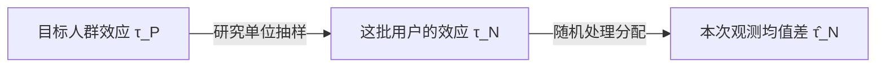

判断一项产品改动是否有效，需要回答一个反事实问题：如果同一批用户没有经历这项改动，其结果将会有何不同？例如，降低新手关卡难度后，某位用户次日仍然活跃，但该用户在原有难度下是否同样会保持活跃，仅凭已观测的结果无法确定。因果效应所比较的，是同一研究对象在不同干预条件下的潜在结果，而在实际实验中我们通常只能观测其中一种。潜在结果模型为这种比较提供了统一的数学表达，使我们能够从个体层面的结果差异，进一步讨论干预对特定人群的平均影响。明确这一比较的含义及其观测限制，是理解 A/B 测试的估计目标、解释实验结果，以及讨论组间差异何时具有因果含义的基础。

<!--more-->

## 从一次理想实验开始

考虑一项针对新用户的新手关卡难度调整实验，目标是通过降低第一关难度，减少新用户早期流失。实验设置两套干预方案：

- **方案 A（对照组）**：保持现有关卡顺序和难度参数。
- **方案 B（实验组）**：仅降低第一关难度，其他关卡、奖励和广告安排均保持不变。

该实验希望回答的核心问题是：**相较于维持现有难度，降低第一关难度能否提高新用户的次日留存率？如果能够提高，提升幅度又是多少**？

要将这一问题转化为可供统计分析的因果问题，需要对研究对象、干预条件和结果变量作出严格定义。否则，即使观察到两组结果不同，也无法准确说明差异对应的因果问题。

首先实验的研究对象定义为 **首次进入新手流程、尚未开始第一关且符合预先规定条件的新用户**，将用户 **首次进入新手流程并满足入组条件的时刻** 定义为入组时点。

本实验以用户作为研究单位。令 $Z_i\in\\{0,1\\}$ 表示研究单位 $i$ 被随机分配的实验方案，其中

$$
Z_i=
\begin{cases}
0,&\text{分配至方案 A}\\
1,&\text{分配至方案 B}
\end{cases}
$$

在本实验中我们假定用户实际接受的关卡方案与随机分配结果一致，因此 $Z_i$ 同时表示用户接受的处理条件。

实验以 **次日留存率** 作为主要结果指标。将用户入组当天定义为第 0 日（D0），入组日期之后的第一个自然日定义为第 1 日（D1）。对于研究单位 $i$，定义二元结果变量

$$
Y_i=
\begin{cases}
1, & \text{研究单位 }i\text{ 在 D1 活跃}\\
0, & \text{研究单位 }i\text{ 在 D1 未活跃}
\end{cases}
$$

其中活跃行为按照实验预先确定的统一标准判定。

两组留存率之差反映了不同处理组之间的观测结果差异。要判断这一差异能否解释为第一关难度调整的因果效应，需要先明确因果效应的数学含义，再讨论观测数据在何种条件下能够识别这一效应。

## 反事实思想与潜在结果

随机变量之间的联合分布与条件分布能够刻画变量之间的统计关联，但统计关联本身并不等同于因果关系。对于处理变量 $Z$ 与结果变量 $Y$，即使我们能够准确估计不同处理组之间的条件期望之差

$$
\mathbb{E}[Y\mid Z=1]-\mathbb{E}[Y\mid Z=0]
$$

但这个差异也只是观测分布的一个特征，并不直接构成因果效应的定义。要赋予这种差异因果含义，首先需要明确因果效应所比较的究竟是什么。

**反事实思想**（Counterfactual Reasoning）为因果效应提供了一种基本的概念化方式：通过比较同一研究对象在不同干预条件下可能产生的结果，刻画干预对结果的因果影响。这一思想的关键在于，因果比较并不是简单地比较接受不同处理的研究对象，而是针对同一研究对象，考察其在不同干预条件下的结果如何变化。

换言之，我们不仅关注某种处理条件下实际发生了什么，还需要考虑 **如果施加的是另一种干预，结果将会如何**？

回到此前的新手关卡实验。对于接受了方案 A 的用户，我们能够观察到他在方案 A 下的次日活跃状态，但无法同时知晓他在方案 B 下的活跃状态；后者描述的正是一个与实际处理条件不同的 **反事实结果**（Counterfactual Outcome）。

反事实思想使因果效应的比较对象得以明确，但要进一步研究因果效应的数学性质，还需要为不同干预条件下的结果建立统一的形式化表示。这便引出了 **潜在结果**（Potential Outcomes）模型。

设研究单位的索引为 $i$，处理变量的取值集合为 $\mathcal{Z}=\\{0,1\\}$。对于任意处理水平 $z\in\mathcal{Z}$，定义潜在结果 $Y_i(z)$ 表示研究单位 $i$ 在接受处理 $z$ 时可能产生的结果。对于本实验，两个潜在结果分别为

$$
\left\{
\begin{aligned}
Y_i(0)&:\text{研究单位 }i\text{ 接受方案 A 时的次日活跃状态}\\
Y_i(1)&:\text{研究单位 }i\text{ 接受方案 B 时的次日活跃状态}
\end{aligned}
\right.
$$

需要强调的是，潜在结果的定义并不取决于研究对象实际接受了哪一种处理。无论用户最终接受方案 A 还是方案 B，我们都可以在概念上定义其对应的两个潜在结果。潜在结果是事实结果还是反事实结果，取决于用户实际接受的方案，具体的情况如下表所示：



| 实际接受的方案 | 方案 A 下的潜在结果 $Y_i(0)$ | 方案 B 下的潜在结果 $Y_i(1)$ |
|:---: |:---: |:---: |
| 方案 A | 事实结果 | 反事实结果 |
| 方案 B | 反事实结果 | 事实结果 |



无论用户实际接受哪一种方案，个体因果效应都比较同一用户在方案 B 与方案 A 下的潜在结果，因此将其就定义为

$$
\begin{equation}\label{eq:个体因果效应}
\tau_i=Y_i(1)-Y_i(0)
\end{equation}
$$

上式将反事实思想转化为明确的数学定义，即个体因果效应是同一研究对象在两种干预条件下的潜在结果之差。这就使得潜在结果模型变成了有了对不同干预条件下结果的统一描述，因果效应由此成为一个具有明确含义的数学对象。

## 超总体下的因果效应

### 超总体的概率模型

个体因果效应刻画的是特定研究对象在两种干预条件下的结果差异。同一项干预对不同研究对象的影响可能不同，而实际研究通常关注干预对某一目标人群的整体影响。因此，需要进一步在总体层面定义因果效应。

为了形式化这一总体层面的因果问题，我们需要引入 **超总体**（Superpopulation）。超总体是指通过概率分布刻画研究单位及其相关属性的总体模型。与将研究对象限定为某个给定的有限个体集合不同，超总体框架将研究单位视为来自目标人群分布的随机实现，并通过该分布描述研究单位之间的变异。

设 $\mathcal{X}$ 为处理前协变量空间，$\mathcal{Y}_0,\mathcal{Y}_1$ 分别为两种处理条件下的潜在结果空间。定义研究单位的特征空间

$$
\begin{equation}
\mathcal{W}=\mathcal{X}\times\mathcal{Y}_0\times\mathcal{Y}_1
\end{equation}
$$

在可测空间 $(\mathcal{W},\mathscr W)$ 上定义概率测度 $\mathbb{P}$，构成概率空间 $(\mathcal{W},\mathscr{W},\mathbb{P})$，并定义随机向量

$$
\begin{equation}
W=(X,Y(0),Y(1))  
\end{equation}
$$

其中 $X$ 表示处理前协变量，$Y(0)$ 与 $Y(1)$ 分别表示两种干预条件下的潜在结果。因此超总体分布 $\mathbb{P}$ 不仅描述了研究单位的协变量分布，还刻画了两个潜在结果的联合分布及其与协变量之间的依赖关系。

记 $P$ 为随机向量 $W$ 在目标人群中的联合分布，即 $W\sim P$。后文使用 $\mathbb{E}_P$ 和 $\underset{P}{\Pr}$ 表示相对于目标人群分布 $P$ 的期望与概率。

这一建模方式使潜在结果具有了明确的概率意义。对于从目标人群中随机抽取的研究对象，$Y(0)$ 和 $Y(1)$ 均为随机变量，其随机性反映了目标人群中不同研究对象之间的差异。需要指出的是，超总体并不要求研究单位的特征空间必须是无限集合。其核心在于通过概率分布描述目标人群，并以该分布作为定义总体参数及开展统计推断的基础。

### 潜在结果的联合分布

在超总体框架下，两个潜在结果构成随机向量，并且有

$$
\begin{equation}
(Y(0),Y(1))\sim P_Y
\end{equation}
$$

其中 $P_Y$ 是目标人群中潜在结果的联合分布。该联合分布不仅包含两个潜在结果各自的边缘分布，还刻画了它们之间的依赖关系。

对于我们的新手关卡实验，由于次日活跃状态是二元变量，即 $Y(0),Y(1)\in\\{0,1\\}$，因此潜在结果的联合分布可以由四个概率完全描述

$$
p_{ab}=\Pr_P(Y(0)=a,Y(1)=b),
\qquad a,b\in\{0,1\}
$$

它们满足

$$
p_{00}+p_{01}+p_{10}+p_{11}=1
$$

四种潜在结果组合分别对应四类研究对象，如下表所示：



| $P(0)$ | $P(1)$ | 个体因果效应 | 含义              |
|:------:|:------:|:------------:|:------------------:|
|  $0$   |  $0$   |      $0$     | 两种方案均无留存  |
|  $0$   |  $1$   |      $1$     | 仅在方案 B 留存   |
|  $1$   |  $0$   |     $-1$     | 仅在方案 A 留存   |
|  $1$   |  $1$   |      $0$     | 两种方案均留存    |



从上面的讨论我们可以看到，潜在结果的联合分布描述的不仅是不同干预条件下的结果分布，还包含了同一研究对象在两种干预条件下可能表现出的差异。

### 个体处理效应的分布

在超总体框架下，个体处理效应

$$
\begin{equation}
\tau=Y(1)-Y(0)  
\end{equation}
$$

同样是随机变量，其分布由潜在结果的联合分布诱导。对于本实验的二元结果变量而言，$\tau\in\\{-1,0,1\\}$。具体来说就是

$$
\Pr_P(\tau=1)=p_{01},
\quad \Pr_P(\tau=-1)=p_{10},
\quad \Pr_P(\tau=0)=p_{00}+p_{11}
$$

这意味着，即使研究对象接受的是同一项干预，其个体因果效应也可能存在差异，即可能存在部分用户因降低第一关难度而留存，部分用户可能因此不再留存，还有部分用户在两种方案下的留存状态相同。这种个体因果效应的差异称为 **处理效应异质性**（Treatment Effect Heterogeneity）。

更一般地，个体处理效应的分布可以由分布函数描述

$$
\begin{equation}
F_\tau(t)=\Pr_P(\tau\leq t)  
\end{equation}
$$

若二阶矩存在，则其方差为

$$
\begin{equation}
\operatorname{Var}_P(\tau)=\operatorname{Var}_P(Y(1))+\operatorname{Var}_P(Y(0))-2\operatorname{Cov}_P(Y(1),Y(0))
\end{equation}
$$

上式揭示了一个重要事实：处理效应的分布不仅取决于两个潜在结果各自的边缘分布，还取决于它们之间的依赖结构。因此即使能够确定两种干预条件下的总体结果分布，也不意味着能够确定个体处理效应的完整分布。

### 超总体平均处理效应

尽管处理效应可能存在异质性，但实际研究往往需要一个能够概括目标人群整体因果影响的参数。若潜在结果具有有限的一阶矩，可以对个体处理效应取总体期望，定义超总体平均处理效应（Superpopulation Average Treatment Effect）为

$$
\begin{equation}\label{eq:超总体平均处理效应}
\tau_P=\mathbb{E}_P[Y(1)-Y(0)]  
\end{equation}
$$

由期望的线性性质可得

$$
\begin{equation}
\tau_P=\mathbb{E}_P[Y(1)]-\mathbb{E}_P[Y(0)]  
\end{equation}
$$

这一等式具有重要意义：平均处理效应只依赖两个潜在结果的边缘期望，而不依赖它们之间的联合依赖结构。这与个体处理效应分布形成了鲜明对比。前者是潜在结果边缘分布的函数，后者一般需要潜在结果的联合分布才能确定。

对于新手关卡实验，由于潜在结果均为二元变量，则

$$
\mathbb{E}_P[Y(z)]=\Pr_P(Y(z)=1),
\qquad z\in\{0,1\}
$$

因此

$$
\tau_P=\Pr_P(Y(1)=1)-\Pr_P(Y(0)=1)
$$

即 $\tau_P$ 为目标人群在方案 B 与方案 A 下的次日留存概率之差。进一步利用潜在结果的联合分布，可以得到：

$$
\begin{aligned}
\tau_P
&=(p_{01}+p_{11})-(p_{10}+p_{11})\\
&=p_{01}-p_{10}
\end{aligned}
$$

这表明对于二元结果变量来说，超总体平均处理效应等于因方案 B 而由不留存变为留存的用户比例，减去因方案 B 而由留存变为不留存的用户比例。

例如 $p_{01}=0.20$，$p_{10}=0.10$，那么则有 $\tau_P=0.10$，即相较于方案 A，方案 B 使目标人群的次日留存率提高了 $10\ \mathrm{pp}$。

值得注意的是，平均处理效应并不能完整描述个体处理效应的分布。即使 $\tau_P=0$，也不意味着所有研究对象的个体因果效应均为零。例如当 $p_{01}=p_{10}>0$ 时，正向效应与负向效应相互抵消，平均处理效应为零，但仍然存在受到干预影响的研究对象。因此平均处理效应描述的是目标人群的平均因果影响，而不是个体因果效应的全部信息。

### 条件平均处理效应

超总体平均处理效应的定义依赖于目标人群分布 $P$，因此 $\tau_P$ 并不是一个脱离研究对象而独立存在的参数。为了进一步理解这一点，考虑研究对象的处理前协变量 $X$。

在条件期望存在的情况下，可以定义条件平均处理效应（Conditional Average Treatment Effect，CATE）为

$$
\begin{equation}
\tau_P(x)=\mathbb{E}_P[Y(1)-Y(0)\mid X=x]  
\end{equation}
$$

由全期望公式有

$$
\begin{equation}
\begin{aligned}
\tau_P
&=\mathbb{E}_P\left[
\mathbb{E}_P\left[Y(1)-Y(0)\mid X\right]
\right]\\
&=\mathbb{E}_P[\tau_P(X)]
\end{aligned}
\end{equation}
$$

这一表达式表明，总体平均处理效应可以表示为不同协变量条件下平均处理效应的加权平均，其权重由目标人群中协变量 $X$ 的分布决定。

对于本实验，$X$ 可以包含用户的来源渠道、设备类型或其他在入组前已经确定的特征。如果不同用户群体对第一关难度调整的反应不同，目标人群的构成便可能影响总体平均处理效应。例如：即使在不同渠道下的条件平均处理效应保持不变，只要各渠道用户在目标人群中的占比发生变化，总体平均处理效应也可能随之改变。因此定义因果效应不仅需要明确干预方案与结果变量，还需要明确因果效应所针对的目标人群。

若预先定义的自然流量与广告投放用户各占目标人群的一半，方案 B 对两类用户的 D1 留存概率影响如下：



| 用户渠道 | 目标人群占比 | D1 留存概率变化 | 加权贡献 |
| :---: | :---: | :---: | :---: |
| 自然流量 | $0.5$ | $+4\ \mathrm{pp}$ | $0.020$ |
| 广告投放 | $0.5$ | $-1\ \mathrm{pp}$ | $-0.005$ |
| 总体 ATE | $1.0$ | — | $+0.015$ |



这里的渠道必须在处理前确定。只分析“完成第一关”或“到达第五关”的用户，相当于按可能受到方案影响的行为筛选，不能直接当作预先定义的 CATE 亚组。即使使用处理前特征，子组划分越细，可供比较的用户通常越少；事后搜索大量子组再只报告效果最大的结果，还会放大偶然差异。探索性发现应与预先指定的分析和后续独立验证区分。

## 有限总体下的因果效应
 
\eqref{eq:超总体平均处理效应} 式描述了目标人群分布 $P$ 下的平均因果影响。但是因果效应并不一定需要通过超总体概率模型来定义。当研究对象被限定为某个给定的有限个体集合时，我们同样可以直接在该集合上定义平均处理效应。

### 有限总体的定义

设研究单位的索引集合为

$$
\mathcal{I}_N=\{1,2,\ldots,N\},
\qquad N<\infty
$$

对于每个研究单位 $i\in\mathcal I_N$，定义其处理前协变量为 $X_i$，以及两种干预条件下的潜在结果为 $Y_i(0)$ 和 $Y_i(1)$。于是将有限总体表示为：

$$
\begin{equation}
\mathcal{U}_N=
\left(i,X_i,Y_i(0),Y_i(1)\right),
\qquad i\in\mathcal I_N
\end{equation}
$$

其中研究单位的索引 $i$ 用于区分不同个体，即使两个研究单位具有完全相同的属性与潜在结果，它们仍然是不同的研究单位。

这里与超总体有所不同，并不要求研究单位来自某个共同的概率分布，也不要求研究单位之间满足独立同分布假设，有限总体直接由这 $N$ 个给定的研究单位及其属性构成。在 Neyman 的经典随机化推断下，给定有限总体 $\mathcal{U}_N$ 后研究单位的潜在结果被视为 **固定值**。也就是说 $Y_i(0)$ 与 $Y_i(1)$ 不再作为抽样模型下的随机变量，而是研究单位 $i$ 在两种干预条件下确定的潜在结果。它们可以彼此不同，也可以存在复杂的个体差异，但这些差异本身并不需要通过随机变量或概率分布加以描述。

因此有限总体框架并不依赖研究单位抽样的随机性，而是直接针对这一给定集合定义因果参数。需要注意的是，这并不意味着有限总体不能与概率模型结合，而是说在经典设计型推断中，统计推断可以条件于一个固定的有限总体进行，随机性由实验设计引入。

### 有限总体平均处理效应

沿用前文的个体因果效应定义，对这 $N$ 个给定研究单位的效应取算术平均，得到有限总体平均处理效应（Finite Population Average Treatment Effect）：

$$
\begin{equation}
\tau_N=\frac{1}{N}\sum_{i=1}^{N}\left[Y_i(1)-Y_i(0)\right]  
\end{equation}
$$

由求和的线性性质可得

$$
\begin{equation}
\begin{aligned}
\tau_N
&=\frac1N\sum_{i=1}^{N}Y_i(1)-\frac1N\sum_{i=1}^{N}Y_i(0)\\
&=\overline Y_N(1)-\overline Y_N(0)
\end{aligned}  
\end{equation}
$$

可以看出，有限总体平均处理效应等于同一有限总体在两种干预条件下的平均潜在结果之差。

对于新手关卡实验，假设我们关注的是某一预先确定的、包含 $N$ 名符合入组条件的新用户的有限集合。由于潜在结果均为二元变量，那么则有

$$
\overline Y_N(z)=\frac1N\sum_{i=1}^{N}Y_i(z),
\qquad z\in\{0,1\}
$$

$\overline Y_N(z)$ 即这 $N$ 名用户在方案 $z$ 下的次日留存比例，$\tau_N$ 表示目标人群在方案 B 与方案 A 下的次日留存比例之差。进一步按两种潜在结果的组合计数，记 $n_{ab}$ 为满足 $Y_i(0)=a$、$Y_i(1)=b$ 的用户数，其中 $a,b\in\\{0,1\\}$，则有

$$
\begin{aligned}
\tau_N
&=\frac{n_{01}+n_{11}}{N}-\frac{n_{10}+n_{11}}{N}\\
&=\frac{n_{01}-n_{10}}{N}
\end{aligned}
$$

也就是说对于二元结果变量，有限总体平均处理效应等于这批用户中因方案 B 而由不留存变为留存的比例，减去因方案 B 而由留存变为不留存的比例。

与超总体平均处理效应一样，$\tau_N$ 不能完整描述这批用户的个体处理效应。即使 $\tau_N=0$，也可能有 $n_{01}=n_{10}>0$，即正向效应与负向效应相互抵消，而部分用户仍受到干预影响。这里比较的是同一批用户分别在两种假设干预条件下的留存率。实际实验中随机分配至不同方案的用户所表现出的观测留存率能否用于估计这一差异，还需要进一步讨论随机化与因果识别问题。

### 有限总体与超总体的联系

从上面的讨论中我们能看到，有限总体平均处理效应与超总体平均处理效应具有相似的数学形式：

$$
\tau_P=\mathbb E_P[Y(1)-Y(0)],
\qquad \tau_N=\frac1N\sum_{i=1}^{N}[Y_i(1)-Y_i(0)]
$$

但二者所针对的研究对象不同。$\tau_N$ 是给定的 $N$ 名用户的平均因果效应，$\tau_P$ 是目标人群分布 $P$ 下的平均因果效应。如果不额外建立抽样模型，二者之间没有必然的数值关系。

假设研究单位从目标人群分布 $P$ 中独立同分布抽取。记每次抽得的处理前特征和潜在结果为 $W_i=(X_i,Y_i(0),Y_i(1))$，则

$$
W_1,\ldots,W_N\overset{\mathrm{i.i.d.}}{\sim}P
$$

从超总体中抽取 $N$ 个研究单位后，得到带有个体索引的有限总体

$$
\mathcal U_N=\{(i,W_i):i\in\mathcal I_N\}
$$

即使两名用户具有相同的特征和潜在结果，索引仍将他们区分为两个研究单位。在抽样发生之前，有限总体平均处理效应是随机样本的函数，即

$$
\tau_N=\tau_N(W_1,\ldots,W_N)
=\frac1N\sum_{i=1}^{N}[Y_i(1)-Y_i(0)]
$$

因此在重复从 $P$ 抽样时，$\tau_N$ 也是随机变量，其取值随抽到的用户而变化。若潜在结果具有有限的一阶矩，则

$$
\begin{equation}
\begin{aligned}
\mathbb E_P[\tau_N]
&=\frac1N\sum_{i=1}^{N}\mathbb E_P[Y_i(1)-Y_i(0)]\\
&=\mathbb E_P[Y(1)-Y(0)]=\tau_P
\end{aligned}
\end{equation}
$$

由此可见在超总体抽样模型下，作为由完整潜在结果构成的有限总体平均效应，$\tau_N$ 是 $\tau_P$ 的无偏估计。进一步，根据强大数定律，在上述独立同分布抽样假设下，有

$$
\begin{equation}
\tau_N\xrightarrow{\mathrm{a.s.}}\tau_P,
\qquad N\to\infty
\end{equation}
$$

给定已经入组的用户及其潜在结果之后，$\tau_N$ 成为这批用户的固定参数。沿用前文的处理分配变量 $Z_i$，并假设用户实际接受的方案与分配一致，干预定义明确且用户之间不存在处理干扰。记研究单位 $i$ 的实际观测结果为 $Y_i^{\mathrm{obs}}$，则

$$
\begin{equation}\label{eq:观测结果方程}
Y_i^{\mathrm{obs}}=Z_iY_i(1)+(1-Z_i)Y_i(0)
\end{equation}
$$

该式称为观测结果方程（Observed Outcome Equation）。处理分配决定两个潜在结果中的哪一个进入实验数据，并不改变潜在结果本身。

记进入实验 B、A 两组的人数分别为 $N_1=\sum\limits_i Z_i$ 和 $N_0=N-N_1$，其中 $N_1,N_0>0$。两组观测均值之差为

$$
\begin{equation}
\widehat\tau_N
=\frac{1}{N_1}\sum_i Z_iY_i^{\mathrm{obs}}
-\frac{1}{N_0}\sum_i(1-Z_i)Y_i^{\mathrm{obs}}
\end{equation}
$$

如果实验在这批用户中固定两组人数并完全随机地分配方案，本次分配得到的 $\widehat\tau_N$ 可能偏离固定的 $\tau_N$。将它与超总体目标比较，可以作如下恒等分解：

$$
\begin{equation}
\widehat\tau_N-\tau_P
=\underbrace{\bigl(\widehat\tau_N-\tau_N\bigr)}_{\text{处理分配带来的偏离}}
+\underbrace{\bigl(\tau_N-\tau_P\bigr)}_{\text{抽样带来的差异}}
\end{equation}
$$

随机分配为第一项的设计型分析提供依据，但不能保证这批实验用户代表未来时期或其他渠道的用户。若要把这批用户的效应推广到目标人群，还需说明抽样机制，或论证处理效应能够迁移。





### 两种总体框架的推断目标

有限总体与超总体的区别，不仅体现在平均处理效应的数学定义上，还体现在统计推断所针对的对象以及随机性的来源上。

在有限总体的经典设计型推断中，研究单位及其潜在结果被视为固定，随机性主要来自处理分配机制。因此推断目标是给定有限总体上的 $\tau_N$。

而在超总体框架下，研究单位及其潜在结果由目标人群概率分布描述。如果实验研究单位是通过随机抽样获得的，那么统计推断还需要考虑研究单位抽样所带来的不确定性，其目标可以是超总体平均处理效应 $\tau_P$。

需要强调的是，有限总体与超总体并不是相互排斥的两种研究方式。对于同一项随机化实验，我们可以把实际入组的研究单位视为固定对象，研究这批单位的有限总体平均处理效应；也可以在适当的抽样模型与假设下，将研究目标扩展至更一般的目标人群。两种框架所使用的潜在结果思想是一致的，但它们定义了不同的因果参数，并可能对应不同的概率模型与推断范围。

## 已处理者效应与分配效应

前面讨论的 $\tau_P$ 与 $\tau_N$ 都对各自目标集合中的所有研究单位取平均。但是在实际研究还需要区分两个问题：平均效应针对哪些研究单位，以及干预指实际接受的方案还是随机分配的方案。为了方便，记 $D_i\in\\{0,1\\}$ 为研究单位 $i$ 实际接受的方案，仍用 $Z_i$ 表示其随机分配的方案。本文的理想实验满足 $D_i=Z_i$，引入 $D_i$ 是为了说明两者不一致时，因果问题会怎样变化。

### 已处理者的平均处理效应

已处理者的平均处理效应（Average Treatment Effect on the Treated，ATT）把目标限定为实际接受方案 B 的研究对象。在超总体框架下，它比较这批对象分别接受方案 B 与方案 A 时的平均结果：

$$
\begin{equation}
\tau_{P,\mathrm{ATT}}=\mathbb E_P[Y(1)-Y(0)\mid D=1]
\end{equation}
$$

这与 $\tau_P=\mathbb E_P[Y(1)-Y(0)]$ 的区别在于取平均的对象。对于实际接受方案 B 的用户，我们能观察到其 $Y(1)$，却仍无法观察同一用户若接受方案 A 会产生的 $Y(0)$，当然 ATT 也面临反事实缺失问题。

在观测研究中，估计 ATT 的一种常用方法是**逆概率加权**（Inverse Probability Weighting，IPW）。设 $X_i$ 为研究单位 $i$ 的处理前协变量，定义倾向得分为

$$
\begin{equation}
e(X_i)=\Pr(D_i=1\mid X_i)  
\end{equation}
$$

即在给定处理前特征的条件下，研究单位接受方案 B 的概率。在一致性、条件可交换性 $(Y(0),Y(1))\perp D\mid X$ 与重叠性 $0<e(X)<1$ 等假设下，可以通过对未处理组加权，使其处理前特征分布与已处理组相对应，从而估计已处理者在接受方案 A 时的平均潜在结果。

记 $\widehat e(X_i)$ 为估计的倾向得分，$Y_i^{\mathrm{obs}}$ 为实际观测结果，则可以构造

$$
\begin{equation}
\widehat\tau_{P,\mathrm{ATT}}^{\mathrm{IPW}}
=
\frac{\sum_{i=1}^{N}D_iY_i^{\mathrm{obs}}}
{\sum_{i=1}^{N}D_i}
-
\frac{
\sum_{i=1}^{N}(1-D_i)
\frac{\widehat e(X_i)}{1-\widehat e(X_i)}
Y_i^{\mathrm{obs}}
}{
\sum_{i=1}^{N}(1-D_i)
\frac{\widehat e(X_i)}{1-\widehat e(X_i)}
}
\end{equation}
$$

第一项是已处理组的观测均值；第二项对未处理组赋予 $\widehat e(X_i)/(1-\widehat e(X_i))$ 的权重，并将权重归一化，用于估计已处理者若接受方案 A 时的平均结果。这就是 ATT 的一种归一化 IPW 估计量，其有效性依赖上述识别假设及倾向得分的正确估计。

在本文的理想随机实验中，$D=Z$，且随机分配不依赖潜在结果。于是从超总体分布来看，

$$
\begin{equation}
\tau_{P,\mathrm{ATT}}
=\mathbb E_P[Y(1)-Y(0)\mid D=1]
=\mathbb E_P[Y(1)-Y(0)\mid Z=1]
=\tau_P
\end{equation}
$$

但这并不意味着某一次随机分配产生的 B 组恰好代表整批有限总体。对已经实现的分配，B 组的个体处理效应平均值为

$$
\frac1{N_1}\sum_{i=1}^{N}Z_i[Y_i(1)-Y_i(0)]
$$

它可能不同于 $\tau_N$，而且其中的 $Y_i(0)$ 无法在这一次实验中直接观察到。

如果实际接受方案 B 的用户并非随机形成，ATT 一般也不等于目标人群的 $\tau_P$。这时直接比较 $D=1$ 与 $D=0$ 两组的观测留存率，可能同时反映处理效应和两组用户原有的差异。只有在足够的识别条件下，才可利用观测数据估计 ATT；处理前特征下的条件平均效应也不能在没有额外条件时直接替代 ATT。

### 意向性治疗效应

意向性治疗效应（Intention-to-Treat Effect，ITT）把随机分配本身作为干预来比较：如果同一研究单位分别被分配至方案 B 与方案 A，结果会相差多少？即使研究单位没有按分配结果接受方案，分析时也仍按原分配组归类。

需要进一步区分 **随机分配**、**系统实际配置** 与 **用户是否接触差异内容**。若 $D_i$ 表示系统实际配置的完整方案，可以用 $D_i(z)$ 表示研究单位 $i$ 被分配至 $z$ 时系统会配置的方案，并写成 $D_i=D_i(Z_i)$。用户被正确配置为 B，却在到达第一关改动内容前退出，属于接触程度不同，并不等于系统没有实施 B；系统错误地向 B 组用户配置 A，才是这里所说的分配与实际处理不一致。



| 情形 | $Z_i$ | $D_i$ | 主要分析中的归组 |
| :---: | :---: | :---: | :---: |
| 分配至 B，正确配置 B，接触了改动内容 | 1 | 1 | 仍在 B 组 |
| 分配至 B，正确配置 B，接触改动前退出 | 1 | 1 | 仍在 B 组 |
| 分配至 B，系统错误配置 A | 1 | 0 | 仍按原分配留在 B 组，另行记录实施偏离 |



为区分分配与实际接受的作用，暂记 $Y_i^{\mathrm{assign}}(z)$ 为研究单位 $i$ 在被分配至方案 $z$ 时的潜在结果。它与前文按实际接受方案定义的 $Y_i(z)$ 回答的是不同问题。相应地，超总体与有限总体的 ITT 分别为

$$
\begin{align}
\tau_{P,\mathrm{ITT}}
&=\mathbb E_P[Y^{\mathrm{assign}}(1)-Y^{\mathrm{assign}}(0)]\\
\tau_{N,\mathrm{ITT}}
&=\frac1N\sum_{i=1}^{N}[Y_i^{\mathrm{assign}}(1)-Y_i^{\mathrm{assign}}(0)]  
\end{align}
$$

在随机分配、两种分配状态均有正概率、分配潜在结果定义明确且结果按预定口径可观测时，超总体 ITT 也可沿用识别推导的结构：

$$
\begin{equation}
\begin{aligned}
\tau_{P,\mathrm{ITT}}
&=\mathbb E[Y^{\mathrm{assign}}(1)\mid Z=1]
-\mathbb E[Y^{\mathrm{assign}}(0)\mid Z=0]
&&\text{（随机分配所支持的可交换性）}\\
&=\mathbb E[Y^{\mathrm{obs}}\mid Z=1]
-\mathbb E[Y^{\mathrm{obs}}\mid Z=0]
&&\text{（按分配定义的一致性）}
\end{aligned}
\end{equation}
$$

固定有限总体时，在完全随机分配下按原分配组计算的均值差同样对 $\tau_{N,\mathrm{ITT}}$ 具有随机化无偏性。在本文的理想实验中，分配决定实际接受的方案，且分配不通过其他途径影响结果，因此 $Y_i^{\mathrm{assign}}(z)=Y_i(z)$，有 $\tau_{P,\mathrm{ITT}}=\tau_P$ 和 $\tau_{N,\mathrm{ITT}}=\tau_N$。

如果存在不依从，按原分配组比较仍针对分配效应，却不能直接解释为实际接受方案的平均处理效应，也不能简单除以“实际接受 B 的比例”来换算。分配可能通过提示、加载或预期等其他路径影响结果，不同用户的处理效应也可能不同。根据是否到达改动关卡而删去用户，还会按可能受到方案影响的行为重新筛选人群。下文讨论反事实缺失时，仍采用 $D_i=Z_i$ 的理想实验设定。

### 不依从下的依从者效应

如果另行关心“实际接受 B 而非 A”的效应，可以进一步研究哪些用户的实际方案会随分配而改变。依从者满足 $D_i(1)=1,D_i(0)=0$；始终接受 B 者满足 $D_i(1)=D_i(0)=1$；从不接受 B 者满足 $D_i(1)=D_i(0)=0$。这是一种按两种可能分配下的实际处理状态定义的分类，单个用户的类型通常无法由一次分配完全观察到。

在随机分配确实影响实际处理、没有反向依从者，并且分配只能通过所定义的实际处理影响结果等额外条件下，分配对结果的效应除以分配对实际处理概率的效应，可以识别依从者平均因果效应（CACE，也称 LATE）：

$$
\begin{equation}
\begin{aligned}
\tau_{P,\mathrm{CACE}}
&=\mathbb E_P[Y(1)-Y(0)\mid D(1)=1,D(0)=0]\\
&=\frac{\mathbb E[Y^{\mathrm{obs}}\mid Z=1]-\mathbb E[Y^{\mathrm{obs}}\mid Z=0]}
{\mathbb E[D\mid Z=1]-\mathbb E[D\mid Z=0]}
\end{aligned}
\end{equation}
$$

这一比值针对的是实际处理状态会随分配改变的依从者，而不是所有用户的平均效应或 ATT。若分配至 B 本身带来提示、加载体验等直接影响，或用户之间存在干扰，所需的排除限制便可能不成立。在没有这些额外条件时，报告按分配得到的 ITT 比把它解释为实际处理效应更有依据。

上述因果参数针对的研究对象或干预含义不同，但都涉及同一研究对象在不同条件下的潜在结果。一次实验通常只能让每个研究对象接受其中一种干预，因此因果参数定义明确，并不意味着它能直接从观测结果中计算出来。下面沿用 $D_i=Z_i$ 的理想实验设定，根据观测结果方程说明另一潜在结果为何缺失。

## 观测结果与反事实缺失

### 反事实结果的缺失

由观测结果方程 \eqref{eq:观测结果方程} 可知，分配至 B 时观测 $Y_i(1)$，分配至 A 时观测 $Y_i(0)$；另一方案下的潜在结果仍是 **反事实结果**（Counterfactual Outcome）。

下表给出两名用户的假设观测记录，结果仍为 D1 是否活跃。“未观测”表示反事实结果未知，而不表示该用户在另一种方案下必然不会活跃。



| 用户 | 随机分配 | 已观测结果 | 未观测的潜在结果 |
|:---:|:---:|:---|:---|
| 甲 | B | $Y_{\mathrm{甲}}(1)=1$，D1 活跃 | $Y_{\mathrm{甲}}(0)$ |
| 乙 | A | $Y_{\mathrm{乙}}(0)=0$，D1 未活跃 | $Y_{\mathrm{乙}}(1)$ |



这不是测量遗漏，即使完整记录所有用户的实际结果，也无法在同一用户、同一干预时点同时观察两种互斥方案下的结果。

### 因果推断的基本难题

个体因果效应 $\tau_i=Y_i(1)-Y_i(0)$ 需要两个潜在结果，而一次实验通常只提供其中一个。因此，无法仅凭研究单位 $i$ 的实际观测数据计算其个体因果效应。这称为 **因果推断的基本难题**（Fundamental Problem of Causal Inference）。

例如，某位用户在方案 B 下次日留存，只能说明 $Y_i(1)=1$，但其 $Y_i(0)$ 仍然未知：若 $Y_i(0)=0$，则 $\tau_i=1$；若 $Y_i(0)=1$，则 $\tau_i=0$。因此，不能仅凭该用户在方案 B 下留存，就断言其留存是由方案 B 造成的。

实际结果描述了发生了什么，而个体因果效应要求比较实际发生的结果与同一研究对象在另一种干预条件下本会发生的结果。

### 从个体反事实缺失到总体因果效应

个体因果效应无法直接观测，并不意味着平均因果效应也无法估计。考虑超总体平均处理效应：

$$
\tau_P=\mathbb E_P[Y(1)]-\mathbb E_P[Y(0)]
$$

与个体因果效应不同，这一参数只涉及两个潜在结果各自的总体期望，而不要求直接观察每个研究对象的两个潜在结果。这一差异具有重要意义。

虽然每个研究对象只能提供一个潜在结果，但不同研究对象可以接受不同的干预。如果处理分配机制满足适当条件，就可能利用不同处理组中的观测结果，分别获得两个潜在结果总体期望的信息。

但是仅仅将研究对象分成两个处理组，并不能保证组间观测结果差异等于平均因果效应。根据观测结果方程，在处理分配与实际处理一致的条件下，有

$$
\begin{align}
\mathbb E[Y^{\mathrm{obs}}\mid Z=1]
&=\mathbb E[Y(1)\mid Z=1]\\
\mathbb E[Y^{\mathrm{obs}}\mid Z=0]
&=\mathbb E[Y(0)\mid Z=0]  
\end{align}
$$

因此观测组间均值差为

$$
\begin{equation}
\begin{aligned}
\Delta_{\mathrm{obs}}
&=\mathbb E[Y^{\mathrm{obs}}\mid Z=1]-\mathbb E[Y^{\mathrm{obs}}\mid Z=0]\\
&=\mathbb E[Y(1)\mid Z=1]-\mathbb E[Y(0)\mid Z=0]
\end{aligned}  
\end{equation}
$$

而我们希望研究的超总体平均处理效应是

$$
\tau_P=\mathbb E_P[Y(1)]-\mathbb E_P[Y(0)]
$$

二者在数学形式上相似，但并不必然相等。前者比较的是实际分配至不同处理组的研究对象所表现出的平均结果，后者比较的是同一目标人群分别接受两种干预时的平均潜在结果。

为了使观测组间差异具有因果解释，我们必须进一步说明：在什么条件下，处理组中的潜在结果分布能够代表目标人群在相应干预条件下的潜在结果分布？这便是因果效应的识别问题，也是随机化实验能够支持因果推断的关键所在。

## 多臂因果效应

前面的新手关卡实验比较方案 A 与方案 B。若再加入方案 C，例如采用另一套预先固定的第一关难度参数，因果问题就扩展为多个方案之间的比较。潜在结果的定义方式仍然适用，但需要同时明确各方案对应的结果，以及研究所关心的比较方式。

### 多臂潜在结果

设共有 $K$ 个方案，将处理水平集合扩展为 $\mathcal Z=\\{0,1,\ldots,K-1\\}$。对于每个研究单位 $i$，定义潜在结果向量

$$
\begin{equation}
\mathbf Y_i=\bigl(Y_i(0),Y_i(1),\ldots,Y_i(K-1)\bigr)^T
\end{equation}
$$

其中 $Y_i(z)$ 表示研究单位 $i$ 接受方案 $z$ 时的潜在结果。在三个方案的新手关卡实验中，$Y_i(0)$、$Y_i(1)$ 和 $Y_i(2)$ 分别表示采用 A、B、C 时的次日活跃状态。这些潜在结果对应同一研究单位、同一入组时点和相同的结果判定口径；各处理水平则应对应预先明确的干预方案。此处的 $0,1,2$ 只是方案编号，并不意味着方案之间存在数量上的大小关系。

将随机分配变量扩展为 $Z_i\in\mathcal Z$。沿用实际接受方案与分配一致、处理定义明确且研究单位之间不存在干扰的设定，观测结果方程为

$$
\begin{equation}
Y_i^{\mathrm{obs}}
=Y_i(Z_i)
=\sum_{z\in\mathcal Z}\mathbf 1\{Z_i=z\}Y_i(z)  
\end{equation}
$$

该式表明，处理分配决定潜在结果向量中的哪一个分量进入实验数据。例如，若研究单位 $i$ 被分配至 B，则观测到 $Y_i(1)$，而 $Y_i(0)$ 与 $Y_i(2)$ 均为未观测的反事实结果。方案数量增加后，每个研究单位仍只能提供一个实际结果，其余 $K-1$ 个潜在结果无法在这一次实验中同时观测。

在超总体框架下，$(Y(z))_{z\in\mathcal Z}$ 构成随机向量。各个 $Y(z)$ 的边际分布描述目标人群采用某一方案时的结果分布，完整向量的联合分布则进一步描述同一研究单位在多个方案下的反应结构。对于二元 D1 结果，三个方案对应的潜在结果向量共有 $2^3=8$ 种可能取值。例如，$(0,1,0)$ 表示该研究单位仅在方案 B 下次日活跃。

即使各方案下的总体留存率均已确定，也无法据此确定这八种反应类型各自的比例。在有效随机分配及相应的结果观测条件下，实验能够提供各方案边际结果的信息，但通常不能识别完整潜在结果向量的联合分布。将实验人群中的结果推广至目标人群，仍需说明两者之间的关系。这一信息边界决定了后续哪些因果问题可以由各方案的平均结果回答。

### 从两两比较到一般线性因果对比

记目标人群采用方案 $z$ 时的平均潜在结果为

$$
\begin{equation}
\mu_P(z)=\mathbb E_P[Y(z)]  
\end{equation}
$$

对于任意两个方案 $a,b\in\mathcal Z$，方案 $a$ 相对方案 $b$ 的超总体平均处理效应为

$$
\begin{equation}
\tau_P(a,b)
=\mathbb E_P[Y(a)-Y(b)]
=\mu_P(a)-\mu_P(b)
\end{equation}
$$

因此，前文的双臂平均处理效应可以直接推广到多臂情况下的两两比较。例如，B 相对 A 的平均效应为 $\mu_P(1)-\mu_P(0)$，C 相对 A 的平均效应为 $\mu_P(2)-\mu_P(0)$。

多方案研究还可以提出涉及多个方案的比较问题。例如，若希望比较 B、C 的平均结果与 A 的结果，则相应参数为

$$
\begin{equation}
\frac{1}{2}\mu_P(1)+\frac12\mu_P(2)-\mu_P(0)
\end{equation}
$$

这一参数也可以解释为两种分配策略的平均结果之差：一种策略让目标人群全部采用 A，另一种策略则以相同概率分配 B 或 C，且分配概率不依赖研究单位的特征和潜在结果。后一种策略的总体平均结果是 $\tfrac12\mu_P(1)+\tfrac12\mu_P(2)$，并不要求同一研究单位同时接受 B 与 C。

这些比较可以统一表示为 **线性因果对比**（Linear Causal Contrast）。设 $c=(c_z)_{z\in\mathcal Z}$ 为预先给定的系数向量，满足

$$
\begin{equation}
\sum_{z\in\mathcal Z}c_z=0  
\end{equation}
$$

定义相应的个体、有限总体与超总体线性因果对比分别为

$$
\begin{align}
\tau_i(c)
&=\sum_{z\in\mathcal Z}c_zY_i(z)\\
\tau_N(c)
&=\frac1N\sum_{i=1}^{N}\tau_i(c)
=\sum_{z\in\mathcal Z}c_z\overline Y_N(z)\\
\tau_P(c)
&=\mathbb E_P\!\left[\sum_{z\in\mathcal Z}c_zY(z)\right]
=\sum_{z\in\mathcal Z}c_z\mu_P(z)
\end{align}
$$

其中 $\overline Y_N(z)$ 是给定有限总体在方案 $z$ 下的平均潜在结果。系数决定比较的方向和权重；系数和为零，使各方案的平均结果同时增加同一常数时，对比值保持不变，因而表达的是处理条件之间的相对差异。

按照 A、B、C 的顺序排列系数，$c=(-1,1,0)$ 对应 B 相对 A 的效应，$c=(-1,\tfrac12,\tfrac12)$ 对应 B、C 的平均结果相对 A 的差异。两两比较因此是一般线性因果对比的特例。这里的“线性”指对潜在结果及其均值作线性组合，并不要求结果与处理水平之间存在某种线性函数关系。

由期望的线性性质，超总体线性因果对比只依赖各方案的平均潜在结果，无须识别潜在结果向量的联合分布。个体层面的 $\tau_i(c)$ 仍涉及同一研究单位在多个方案下的结果，通常无法由其一次实验中的观测数据直接计算。

### 以最优处理为研究目标

当研究目的在于选择统一实施的方案时，可以直接将最优处理定义为

$$
\begin{equation}
z_P^\star\in\underset{z\in\mathcal Z}{\arg\max}\ \mu_P(z)
=\underset{z\in\mathcal Z}{\arg\max}\ \mathbb E_P[Y(z)]
\end{equation}
$$

该目标要求寻找使目标人群平均结果最大的方案。若多个方案并列最优，上式中的最优方案可以不唯一。各方案均值能够识别时，最优方案集合也由这些均值确定；实际数据中的估计误差则意味着，样本均值最高的方案未必就是真实的最优方案。

### 平均最优与个体最优

$z_P^\star$ 是全体统一采用一种方案时的平均最优选择。对于研究单位 $i$，其个体最优方案则定义为

$$
\begin{equation}
z_i^\star\in\underset{z\in\mathcal Z}{\arg\max}\ Y_i(z)
\end{equation}
$$

不同研究单位的 $z_i^\star$ 可以不同，且不必等于平均最优方案 $z_P^\star$。统一选择与逐人选择所对应的最优平均结果满足

$$
\begin{equation}
\underbrace{\max_{z\in\mathcal Z}\mathbb E_P[Y(z)]}_{\text{统一方案的最优平均结果}}
\ \leq\
\underbrace{\mathbb E_P\!\left[\max_{z\in\mathcal Z}Y(z)\right]}_{\text{逐人选择的理想平均结果}}
\end{equation}
$$

右侧假定能够获知每个研究单位的全部潜在结果，并据此选择方案，因此是一个理想化的目标。左侧只依赖各方案均值，右侧一般还依赖潜在结果向量的联合分布。各方案均值已知，并不意味着能够确定每个研究单位的最优方案，或计算逐人选择所能达到的理想平均结果。

### 剂量—反应关系

若处理水平具有明确的数量含义，例如某个关卡难度参数的不同取值，可以用剂量 $d$ 表示处理水平，记剂量集合为 $\mathcal D\subseteq\mathbb R$。定义目标人群的平均剂量—反应函数为

$$
\begin{equation}
\mu_P(d)=\mathbb E_P[Y(d)],
\qquad d\in\mathcal D
\end{equation}
$$

其中 $Y(d)$ 表示接受剂量 $d$ 时的潜在结果。剂量从 $d_1$ 变为 $d_2$ 的平均因果效应为

$$
\begin{equation}
\tau_P(d_2,d_1)=\mu_P(d_2)-\mu_P(d_1)
\end{equation}
$$

该函数描述平均结果如何随干预强度变化。若剂量取离散值，研究的是这些水平下的平均结果及其差异；若剂量在某一区间内连续取值，则相应目标是一条剂量—反应曲线。方案编号本身不具有剂量含义，剂量增加也不意味着结果必然单调变化。有限个试验水平之外的结果，仍需额外假设才能推断。
